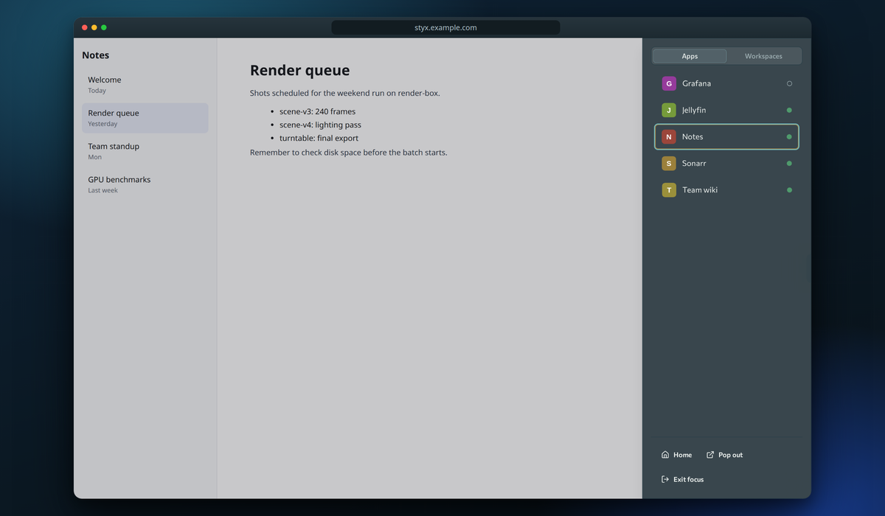
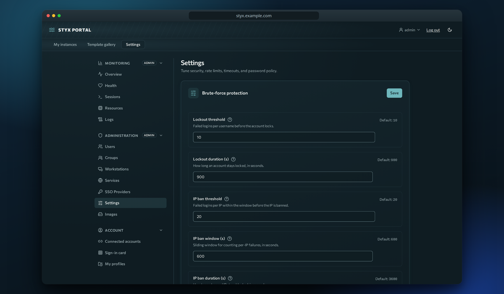
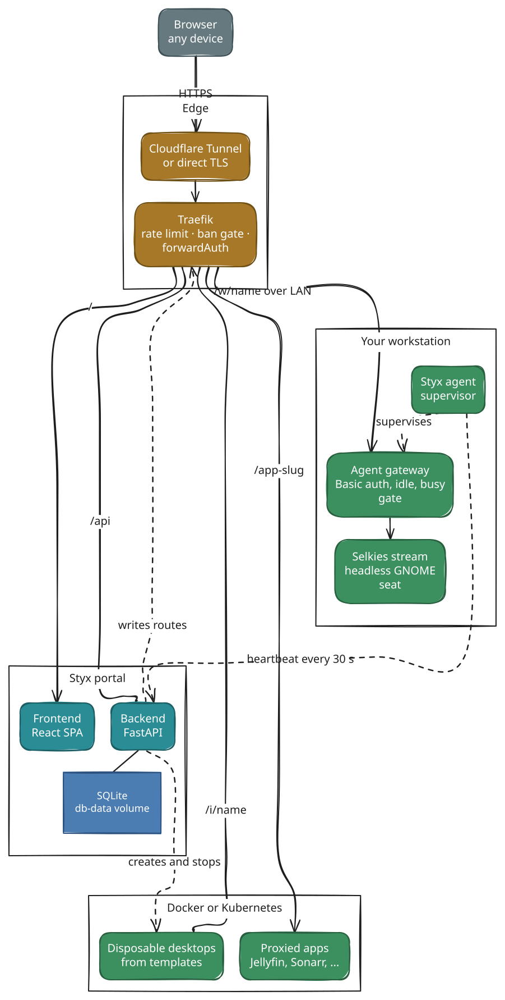

<h1 align="center">Styx Portal</h1>

<p align="center">
  
</p>

<p align="center">
  <a href="https://github.com/selkies-project"></a>
</p>
<p align="center">
  <b>Streaming powered by the <a href="https://github.com/selkies-project">Selkies Project</a></b><br>
  <a href="https://github.com/selkies-project/selkies"></a>
  <a href="https://github.com/selkies-project/pixelflux"></a>
  <a href="https://github.com/selkies-project/pcmflux"></a>
</p>
<p align="center"><sub>
  selkies, pixelflux and pcmflux do the hard part: capture, hardware encoding, the WebSocket/WebRTC
  transports and the browser client. Their maintainers answered our bug reports with root-cause fixes
  and reviewed our patches with real care. If Styx is useful to you, please
  <a href="https://github.com/selkies-project/selkies">star and support Selkies</a>.
</sub></p>


<!-- Status -->
[](https://github.com/sgtslaughta/styx-portal/actions/workflows/ci.yml)
[](https://github.com/sgtslaughta/styx-portal/actions/workflows/release.yml)
[](https://sgtslaughta.github.io/styx-portal/)
[](https://gitlab.com/sgtslaughta/styx-portal/-/pipelines)

<!-- Project -->
[](https://github.com/sgtslaughta/styx-portal/tags)
[](LICENSE)
[](https://github.com/sgtslaughta/styx-portal/commits/main)
[](https://www.conventionalcommits.org)
[](https://github.com/semantic-release/semantic-release)

<!-- Stack -->


> **Your machines and your apps, in a browser tab.** Styx Portal is a self-hosted platform that launches containerized Linux desktops, streams your physical workstations at low latency, and puts your home-lab apps behind one sign-in.

## Why Styx

I routinely need to reach things running at home, from somewhere else, with nothing but a browser. The alternatives I tried were slow or choppy, needlessly complex, paywalled, abandoned, or made me reverse-engineer them to do what I wanted. So the requirements were simple: easy to use, clientless, fast, and with the nice things included (audio, copy/paste, upload/download, SSO).

The spark was [LinuxServer.io](https://www.linuxserver.io/) moving from Kasm Workspaces to `project selkies`-based images. Once I saw the performance, I wanted the whole platform around it.

## What you get

### Stream a real workstation

Enroll a Linux machine with one command and open its desktop in the browser. A private GNOME seat runs beside your login session (the physical screen is untouched), encoded on the GPU with AV1, HEVC or H.264, with audio, two-way clipboard and file transfer.

### Launch disposable desktops

Pick a template (XFCE, developer, gaming, or your own Selkies image), and get a persistent containerized desktop at its own address. Idle desktops pause themselves; GPU passthrough is one switch.

### One front door for your apps

Put Jellyfin, the \*arr stack, Nextcloud, Home Assistant and friends behind one hostname with SSO and group access. Styx can set an app's base path for you (with backup and rollback), and every app opens in a framed shell with a draggable dock.



### Administer it from the UI

Users, invites, groups, OIDC/OAuth2 SSO, printable sign-in cards for 2FA, brute-force protection, live-tunable settings, and a health page with history.



### Also

- Docker Compose for the core; Kubernetes manifests for k3s
- Per-user isolation, audit log, CSRF, CSP/HSTS, refresh-token reuse detection
- Tested on Ubuntu 24.04 with Wayland; other Debian-family systems should work. No Windows or macOS agent yet: send a demand signal if you want one.

## Quickstart (about 60 seconds)

You need Docker with Compose v2, a domain, and a [Cloudflare Tunnel token](https://developers.cloudflare.com/cloudflare-one/connections/connect-networks/).

```bash
git clone https://github.com/sgtslaughta/styx-portal.git
cd styx-portal
cp .env.example .env          # set DOMAIN and CF_TUNNEL_TOKEN
docker compose up -d
```

Open `https://<your domain>`, enter the setup code from `docker compose logs backend | grep "setup code"`, and create the admin account. No domain? See the [install guide](https://sgtslaughta.github.io/styx-portal/operate/install/) for direct TLS and local options.

> [!CAUTION]
> Do not leave it bare on the internet. Put it behind a Cloudflare Access application or another second factor. See [Security](https://sgtslaughta.github.io/styx-portal/operate/security/).

## How it fits together

Browser, Traefik (TLS, rate limits, forwardAuth), FastAPI backend and React frontend, then Docker (or Kubernetes) for desktops and proxied apps, and a small agent on each enrolled workstation running Selkies behind an authenticated gateway. Details: [architecture](https://sgtslaughta.github.io/styx-portal/build/architecture/).

<picture><source media="(prefers-color-scheme: dark)" srcset="docs/assets/diagrams/readme-1-dark.svg"></picture>

## Documentation

The site at **<https://sgtslaughta.github.io/styx-portal/>** has three paths:

| | |
|---|---|
| [**Use**](https://sgtslaughta.github.io/styx-portal/use/) | Sign in, desktops, workstations, apps, troubleshooting |
| [**Operate**](https://sgtslaughta.github.io/styx-portal/operate/) | Install, production, Kubernetes, enrolling, users and SSO, settings, streaming tuning |
| [**Build**](https://sgtslaughta.github.io/styx-portal/build/) | Architecture, backend, frontend, agent, testing, CI/CD, ADRs |

## FAQ

**Is it vibe coded?** Of course. I do not have months to grind, and I know much of this stack well enough to steer it. If that bothers you, you do not have to use it; fork it and hand-jam your own.

**Is it secure?** I put real thought into it. Is it Fort Knox? Not even close, but it should be fine for most people. Found an issue? Please tell me.

**Did I test every surface?** No. Bugs are likely on the fringes. Open an issue.

## Contributing

Start with [CLAUDE.md](CLAUDE.md) for the project layout and commands, and the [contributing guide](https://sgtslaughta.github.io/styx-portal/build/contributing/). Commits follow **Conventional Commits** (enforced by commitlint), which drives automated releases and the changelog, for example `feat(agent): add reconnect backoff`.


## Standing on the shoulders of giants

Styx is glue around other people's outstanding work, and it could not exist without them.

- **[The Selkies Project](https://github.com/selkies-project)**: see the top of this page.
- **[LinuxServer.io](https://www.linuxserver.io/)** — the `baseimage-selkies` desktop images (and the move
  to Selkies that inspired this project).
- **GNOME/Mutter, PipeWire, Traefik, FastAPI, React** and many more — see
  [Acknowledgements](https://sgtslaughta.github.io/styx-portal/acknowledgements/).

## License

GPL-2.0. See [LICENSE](LICENSE).
