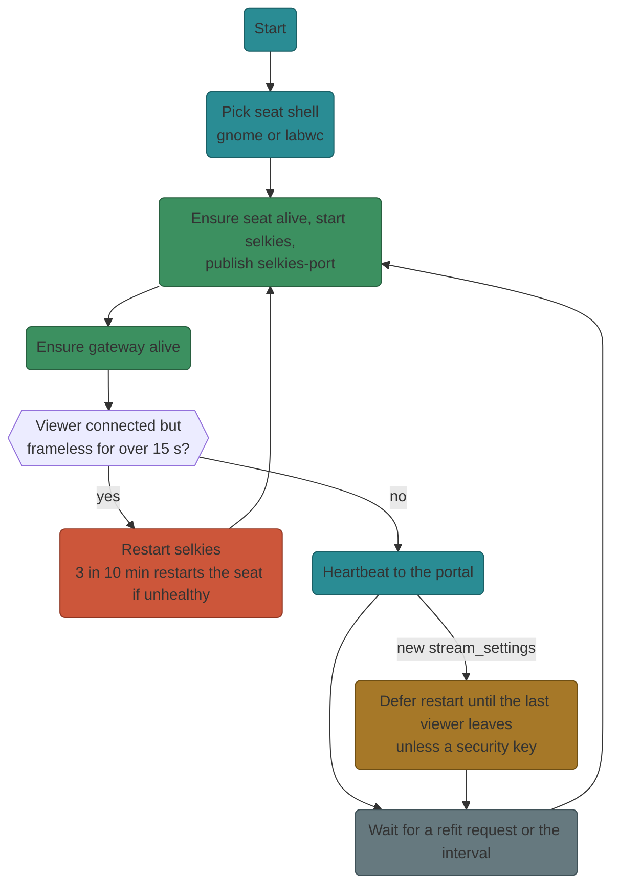
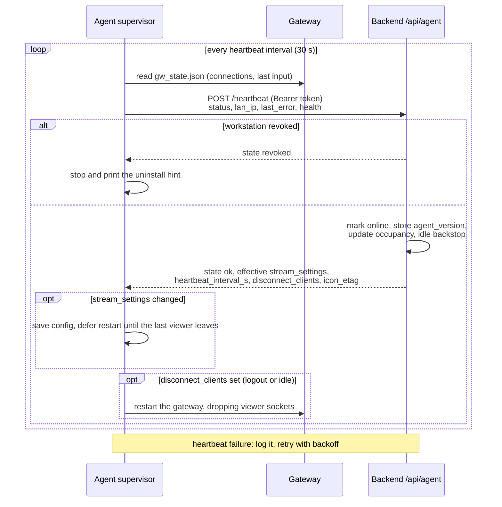
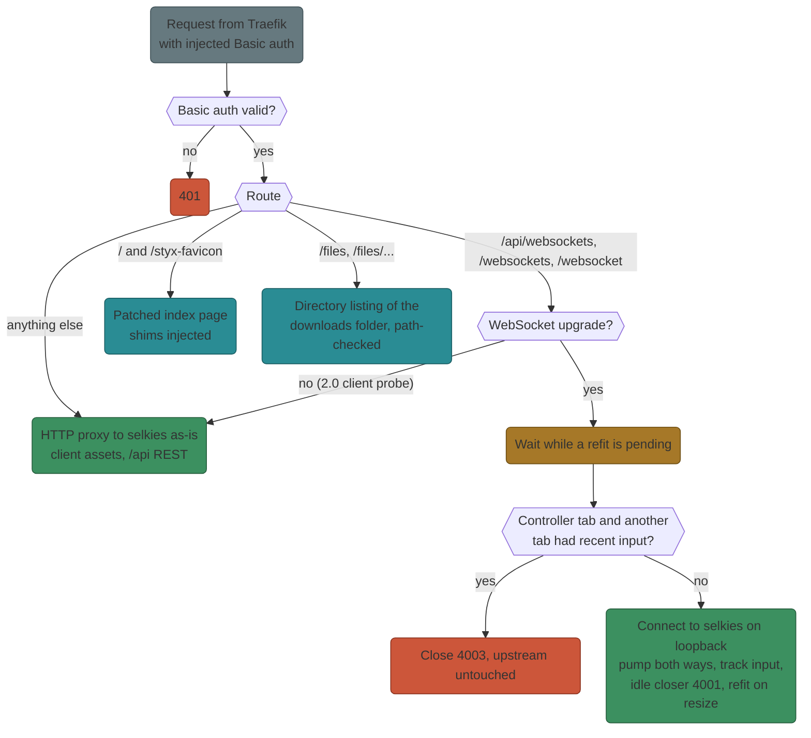
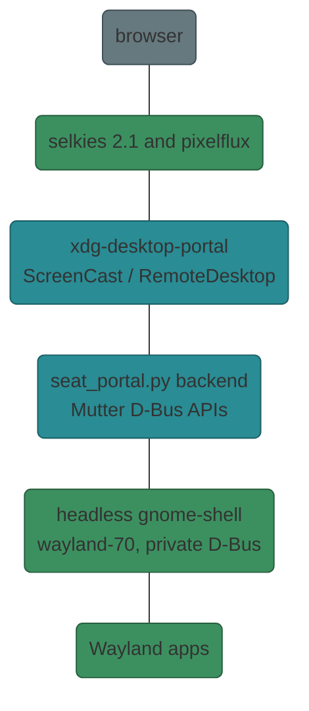
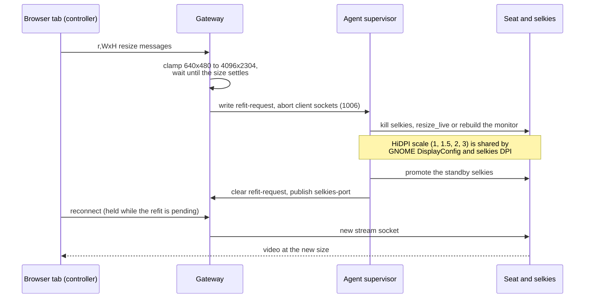

# Workstation agent

The agent turns an ordinary Linux box into a streamable workstation. It is a
small Python supervisor (`agent/styx_agent.py`) that runs three things: the
**seat** (the desktop being streamed), **selkies** (capture + encode), and the
**gateway** (auth + proxy in front of selkies). Operator tasks (enroll, update,
troubleshoot) are in the Operate section.

## Modules

| File | Role |
|------|------|
| `enroll.sh` | Enrollment and `--upgrade` installer (8 steps, preflight codes E01-E08) |
| `styx_agent.py` | Supervisor: heartbeat, config, restarts, `run`/`status`/`doctor`/`rollback`/`uninstall` |
| `agent_procs.py` | Child-process helpers, restart planning, gateway command/env |
| `engine.py` | Pure builders for the selkies command, encoder probe, audio/sink helpers |
| `gateway.py`, `gateway_html.py`, `viewers.py`, `refit.py` | The gateway and its per-tab bookkeeping |
| `seat_gnome.py`, `seat_portal.py`, `seat_systemd.py`, `seat_scale.py`, `seat_clipboard.py`, `seat_thumb*.py` | Headless GNOME seat |
| `seat_labwc.py`, `clipboard_bridge.py` | labwc fallback seat |
| `shallow_pipe.py`, `bundle_patch.py` | Runtime patches applied to selkies 2.1 |
| `health.py`, `portal_api.py`, `favicon.py` | Health readers, portal HTTP helpers, favicon relay |
| `uninstall.sh` | Standalone removal |

## Capture modes

| Mode | Captures | Used when |
|------|----------|-----------|
| **mirror** | A live X11 display via XShm; resolution locked to the physical screen | X11 session present and mirror not disabled |
| **seat** | A private Wayland desktop beside the login session; the physical screen is untouched | Wayland, headless, or mirror disabled |

!!! note "Why mirror is X11-only"
    Mirror attaches to an existing X server. Wayland has no standard way to
    capture another session, so Wayland hosts always use seat mode.

Within seat mode the shell is `gnome` (default, needs GNOME Shell 46 or newer) or
`labwc` (automatic fallback when GNOME is missing or too old). The choice is
`stream_settings.seat_shell`; changing it makes the agent exit so systemd
(`Restart=always`) relaunches it on the new shell.

## Enrollment (`enroll.sh`)

One-liner minted by an admin. Eight steps with failure codes shown on error:

| Step | Check | Code |
|------|-------|------|
| 1 | curl, tar, openssl (if pinning), python3 >= 3.10 with venv, free disk, glibc >= 2.34 | E01 |
| 2 | Choose mirror or seat (mirror needs an X display) | E02 |
| 3 | Server reachable; TLS fingerprint matches `--ca-pin` | E05 / E06 |
| 4 | PipeWire or PulseAudio present | E04 |
| 5 | Install desktop and GPU packages one at a time (a missing name must not abort the rest) | E03 |
| 6 | Selkies port free, `systemd --user` available | E07 / E08 |
| 7 | Download agent files and artifacts, create venv, install wheels | E01 / E03 / E05 |
| 8 | Register with the portal (one-time enroll token), write config and the systemd user unit | E05 |

`--upgrade` reuses the existing config, moves the old install to `<install>.prev`
and restores it on any failure. `styx_agent.py rollback` swaps the two
directories and restarts the service.

### Self-update file list

The backend serves agent files from `AGENT_DIR` (`/app/agent`, the repo's
`agent/` mounted read-only). The list of files the installer fetches is
`AGENT_UPDATE_FILES` in `backend/app/services/workstations.py`, mirrored by the
`for pair in ...` loop in `enroll.sh`.

!!! warning "Adding an agent module"
    A new `agent/*.py` module must be added to **both** `AGENT_UPDATE_FILES` and
    the `enroll.sh` file loop, or upgraded workstations will crash with
    `ImportError`. `agent/tests/test_packaging.py` guards this.

The agent version (`AGENT_VERSION` in `styx_agent.py`) is an independent stream
from the repo release; the backend compares it to enrolled agents to show an
"update available" badge.

## Supervision loop (`styx_agent.run`)



Key behaviours:

* **Heartbeat** (`POST /api/agent/heartbeat`, bearer token, ~30 s): reports status, last error, health (connections, idle, GPU/host tuning) and receives resolved `stream_settings`, `heartbeat_interval_s`, a `disconnect_clients` one-shot and a `revoked` state (agent stops and prints the uninstall command).
* **stream_settings** are resolved server-side (`ws_settings.resolve_stream_settings`): per-workstation override over system default, plus idle timeout, seat shell and seat size. Config is rewritten to `~/.config/styx-agent/config.json`.
* **Deferred apply** (`agent_procs.settings_restart_keys`, `restart_plan`, `merge_pending`): a settings push restarts the affected processes only when no viewer is connected, so a change never kills a live session. Idle-timeout keys (`IMMEDIATE_KEYS`) apply immediately. A framerate change relaunches only the capture helper (`portal`); seat shell or size changes restart the seat.
* **Watchdog**: a viewer connected with no video for `FRAME_START_TIMEOUT_S` (15 s) restarts selkies. `Escalation` (3 restarts in 10 minutes) restarts the whole GNOME seat only if it no longer answers D-Bus.
* **Standby selkies**: on the GNOME seat a second, idle selkies is kept booted; a refit promotes it to avoid a process start inside the viewer's hold.
* **Backoff**: selkies crash restarts back off 2 s doubling to 60 s.
* `doctor` prints pass/fail checks (config, venv, selkies, GPU node, audio monitor, service, gateway port, TLS pin, server reachability) plus advisory host tuning.

### Heartbeat exchange



## Gateway (`gateway.py`)

An aiohttp reverse proxy bound to the LAN port, forwarding to selkies on loopback
(`selkies-port` file is re-read per request, so standby promotion is seamless).

| Concern | Behaviour |
|---------|-----------|
| **Auth** | HTTP Basic on every request (`STYX_GW_USER`/`STYX_GW_PASSWORD`, passed by env, not argv). Traefik injects it for portal users. |
| **Idle enforcement** | Authoritative: closes a tab's socket with code `4001` after `idle_timeout_s` without input from that tab. Config from `STYX_GW_IDLE_*` env; a page-side watchdog shim shows the "pausing soon" countdown `idle_warn_lead_s` earlier. |
| **Viewers / busy** | Each tab has a stable `styx_vid` (stripped before reaching selkies). A new controller tab is refused with close code `4003` while another had input within the idle timeout (300 s when idle enforcement is off); the first seconds of a socket (`CONNECT_QUIET_S`) do not count as input. `role=viewer` shared connections are exempt. |
| **Size owner** | `SizeOwner` in `refit.py`: the controller owns the seat size; released when it leaves. |
| **Refit** | See [below](#refit-and-scale-chain). |
| **State file** | `gw_state.json`: active connections, last input, `stream_starving`; read by the supervisor each pass. |
| **Keep-alive** | WebSocket pings every 30 s keep hidden tabs alive through proxies. |

### Request routing



### Injected shims (`gateway_html.py`)

The gateway rewrites selkies' HTML to add:

* `inject_title` / `inject_favicon`: hostname title and the workstation icon;
* `inject_idle_watchdog`: idle countdown and "I'm here" handling; includes a **visibility shim** so a hidden iframe does not send STOP_VIDEO (which caused black "Waiting for stream" screens; `VIS_GRACE_MS`);
* `inject_cursor_hide`: hides the server-drawn cursor on the seat (browser draws it);
* `inject_touch_scroll`: touch scrolling for mobile browsers;
* `refit.inject_reload`: per-tab id plus reload on refit.

## Engine (`engine.py`)

`build_selkies_cmd(cfg, internal_port, seat)` returns `(argv, env)`. Secrets travel
by env, never argv. Highlights:

* `--mode=websockets`, `--enable-basic-auth=false` (gateway owns auth), `--second-screen=false`; printing, microphone, webcam, gamepad and 10-bit are disabled and locked.
* **Encoder list**: `--encoder=<hw encoders...>,h264enc`. selkies tries them in order and steps down to the first the browser can decode: AV1 -> HEVC -> H.264.
* **Probe** (`hw_encoders`, cached per render node): `vainfo --display drm --device <node>` lists VA-API encode profiles (`VAProfileAV1` -> `av1enc`, `VAProfileHEVC` -> `h265enc`). If VA-API shows neither, NVIDIA is probed by `nvidia-smi --query-gpu=compute_cap`: AV1 from compute capability 8.9 (Ada), HEVC from 5.2 (Maxwell 2). With no GPU node only H.264 is offered; software AV1/HEVC are never advertised because they would pin the CPU.
* DRI node flags and `SELKIES_USE_CPU=false|locked` keep the GPU encoder on.
* **Bitrate**: `--video-bitrate=<kbps>,<lo>-<kbps>`; the admin value is default and ceiling (default 30 Mbps, floor 1 Mbps). Rate control is CBR; paint-over re-sharpens text when the screen settles. 4:4:4 chroma is opt-in.
* **Audio**: the seat uses a null sink `styx-seat` so seat audio never reaches host speakers; its monitor is the capture device.
* **Stream override hook**: `apply_stream_override()` appends flags from `<install>/stream-override.json` (`{"args": [...]}`) to selkies' argv; argparse keeps the last value. The A/B harness uses it to swap encoder and bitrate without touching the seat. Dev only; production settings still come from the portal.
* `seat_selkies_main()` (`python engine.py <selkies args>`) wraps selkies for the GNOME seat: routes clipboard calls to `seat_clipboard`, and installs the `shallow_pipe` patches (owner lag gate, congestion tracing) when `selkies.__version__` is the one they were written for.
* `bundle_patch.apply()` re-applies the AV1 crop to selkies' web bundle at each agent start (lost on reinstall). See [Upstream](upstream.md).

## Seats

### GNOME seat (default)



* `seat_gnome.GnomeSeat` runs `dbus-run-session -- gnome-seat.sh`, starting `gnome-shell --headless` on socket `wayland-70` (snap AppArmor only allows `wayland-[0-9]*`) with a private session bus. `ready()` waits for the bus file, the socket and a D-Bus Ping.
* `seat_portal.py` runs under the **system** python (needs dbus-python, PyGObject, GStreamer `pipewiresrc`). It implements a portal backend `org.freedesktop.impl.portal.desktop.styx` for ScreenCast and RemoteDesktop on Mutter's own APIs, so **no consent dialog** appears. The cursor travels as metadata and the browser draws it. It also holds the seat's virtual monitor at WxH; a new size means a new helper process (renegotiating caps in place stalls frames).
* `seat_systemd.py` answers `org.freedesktop.systemd1` for gnome-shell and relays `snap.*.scope` units only.
* **Clipboard**: Mutter has no wlr/ext data-control, so `seat_clipboard.py` serves the seat clipboard (all flavours, capped 64 MiB each) from the RemoteDesktop session over a unix socket; `engine` points selkies' clipboard calls there.
* **Thumbnails** (`seat_thumb.py` + `seat_thumb_grab.py`): once a minute a long-lived system-python helper grabs one frame via Mutter ScreenCast/PipeWire, and the agent uploads a 1280-wide JPEG to `/api/agent/thumbnail`. The ScreenCast session is never stopped per grab because ending one froze gnome-shell 25-75 s on GNOME 50. The agent gives up (logged once) if the helper keeps failing.
* The seat needs GNOME Shell 46 or newer, `xdg-desktop-portal(-gnome)`, `dbus-run-session`, `gdbus`; `enroll.sh` does not install them. If missing the agent falls back to labwc.

### labwc seat (fallback)

```
pixelflux (outer compositor, captured)
  └── seat Wayland socket
        └── labwc (nested WM; config generated into <install>/labwc)
              ├── swaybg (generated wallpaper), waybar top + bottom dock
              ├── nwg-drawer (app grid), xdg-desktop-portal(+gtk)
              └── host apps join the seat socket
```

Config generators are pure functions in `seat_labwc.py`
(`build_waybar_config`, `build_waybar_dock`, `build_root_menu`, `build_labwc_rc`,
`build_labwc_environment`, `build_autostart`, `wallpaper_convert_cmd`), each unit
tested. `clipboard_bridge.py` mirrors the clipboard between pixelflux's socket and
labwc's by polling.

Design decisions that still matter:

* **Config isolation**: the seat runs as the user, so `XDG_CONFIG_HOME` is never set; labwc gets `-C <install>/labwc` and waybar gets explicit `-c/-s`.
* **Server-built artifacts**: workstations never compile or add third-party apt sources. `scripts/build_agent_artifacts.sh` (needs only Docker, run on the portal host) builds `wheelhouse-x86_64.tar.gz` (selkies, pixelflux, pcmflux wheels for cp310-cp314 in a manylinux container) and `nwg-shell-x86_64.tar.gz` (`nwg-drawer`, via a golang + GTK3 container). They are registered in `services/artifacts.py::ARTIFACTS`, served at `/api/enroll/artifacts/{name}` and extracted by `enroll.sh`. `<install>/bin` is prepended to `PATH` by the agent.
* **nwg-drawer pinned to v0.5.2**: v0.6+ is GTK4, whose layer-shell libs are missing on Ubuntu 24.04. `fuzzel` is the fallback launcher, then the labwc root menu.
* **Bottom waybar dock instead of nwg-dock**: nwg-dock speaks sway IPC and fatals under labwc.
* **Dark mode three ways**: `GTK_THEME=Adwaita-dark`, `gsettings color-scheme prefer-dark`, and `xdg-desktop-portal(+gtk)` launched from `/usr/libexec` so browsers read `color-scheme`.
* **No Exit button** (it tore down the UI while the agent kept supervising) and **no desktop icons** (wlroots has no desktop-icon manager).
* **Wallpaper**: ImageMagick renders hostname, IP and OS over a sine-wave field; flat colour if ImageMagick is missing.
* **Per-package installs**: `SEAT_PKG` list installed one by one.

Refresh artifacts after changing the build script:

```bash
scripts/build_agent_artifacts.sh   # writes ./data/artifacts
docker cp data/artifacts/nwg-shell-x86_64.tar.gz <backend-container>:/app/data/artifacts/
```

## Refit and scale chain

The browser tells selkies its size with `r,WxH[,display]` messages. The seat
follows the controlling tab:

1. The gateway watches `r,` messages (clamped to 640x480 - 4096x2304, 16 px tolerance). Once a size has held `SETTLE_S` and differs from `<install>/seat-size`, it writes `<install>/refit-request` and aborts every client socket (browser sees 1006). A minimum interval (3 s) prevents thrash and `REFIT_HOLD_S` blocks handoffs right after a refit.
2. The supervisor wakes on the request, kills selkies (SIGKILL; it has nothing to flush), resizes the virtual monitor in place (`resize_live`) or rebuilds it (`refit`), promotes the standby selkies, and clears the request. The gateway holds new upgrades until then (`REFIT_WAIT_S`).
3. selkies 2.1 reconnects in place; a full page reload is covered by a hold page.
4. **Scale** (`seat_scale.py`): HiDPI browsers send device pixels, and DPI maps to a shared scale from `SCALES = (1.0, 1.5, 2.0, 3.0)` (ties round up). The scale is applied to GNOME through Mutter DisplayConfig (`apply_scale`), and selkies uses the same value so pointer mapping (`_abs` x scale) agrees. On a scaled seat the portal refuses `ConnectToEIS` so input falls back to portal `Notify*` calls (libei regions are logical, pixelflux sends physical pixels). A scale change restarts selkies once panel clicks settle (`SCALE_SETTLE_S`).



!!! tip "Controller handoff"
    selkies keeps one controller and kills the previous one on a new connect.
    Without the `4003` busy gate a stale tab on another machine would
    ping-pong with the active session and trigger seat restarts.

## Uninstall

`styx_agent.py uninstall` (or standalone `uninstall.sh`) disables the service,
deregisters from the portal (best effort), and removes the unit, config, install
directory and the `.prev` upgrade backup. A `revoked` heartbeat tells the agent
to stop and print this command.

## Tests

`agent/tests/` (pytest; modules `importorskip` aiohttp/dbus so they run on a
bare box). Run with the backend venv; see [Testing](testing.md).
