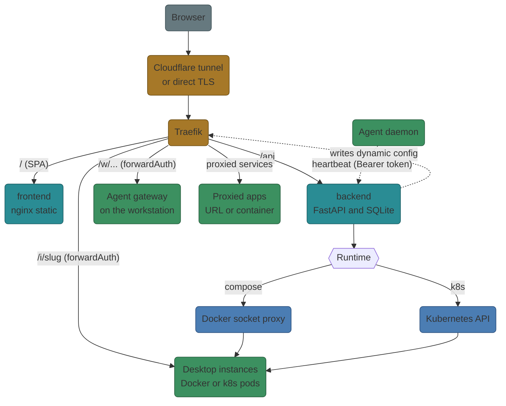
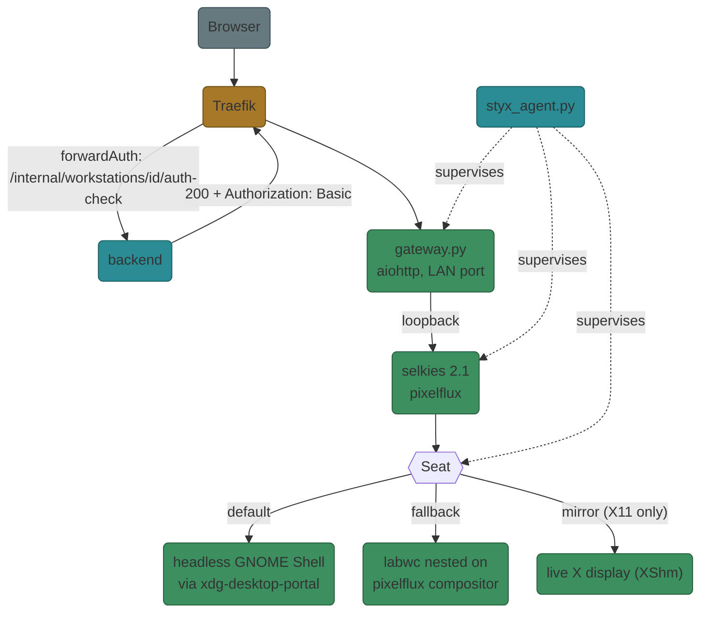
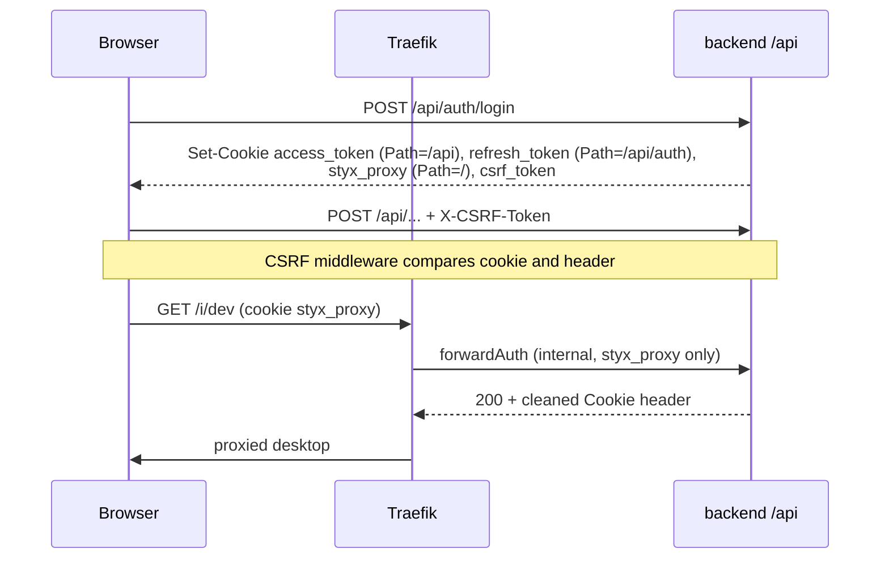
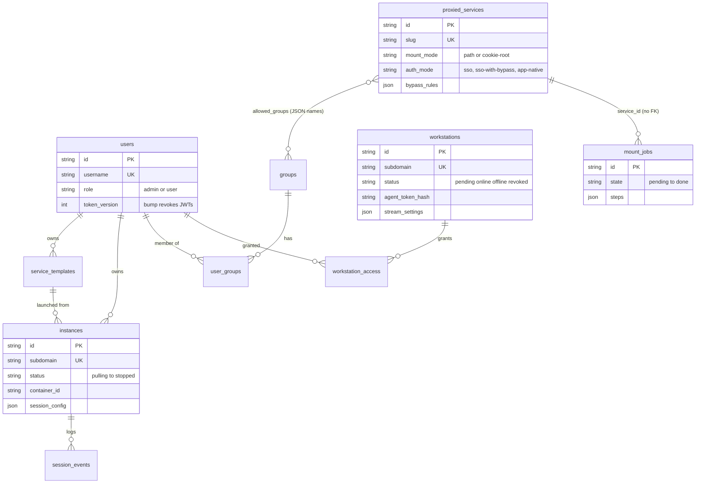

# Architecture

How a request travels from the browser to a desktop, and which component owns
each step.

## System overview

* **Traefik** is the only public entry point. Routers for instances, workstations
  and proxied services are generated by the backend as a *file provider*
  config (`route_writer.py`), not from Docker labels.
* **backend** owns identity, the database, runtime control and routing config.
* **frontend** is a static React build; the backend never renders UI except small
  error and notice pages (`security/page_style.py`).

## Workstation path

1. Traefik asks the backend whether the `styx_proxy` cookie user may open the
   workstation. On success the backend returns the user's `Cookie` header minus
   Styx cookies and an `Authorization: Basic` header for the gateway.
2. The gateway (Basic auth, idle enforcement, injected shims) reverse-proxies to
   selkies on loopback.
3. selkies captures the seat through pixelflux and streams to the browser.

Details: [Agent](agent.md), [Streaming](streaming.md).

## Request and auth flow

| Cookie | Path | Purpose |
|--------|------|---------|
| `access_token` | `/api` | Short-lived JWT (default 15 min) for the API |
| `refresh_token` | `/api/auth` | Rotated refresh token (default 7 days); reuse is detected |
| `styx_proxy` | `/` | Token for forwardAuth only; the API refuses it |
| `csrf_token` | `/` | Double-submit CSRF value, echoed in `X-CSRF-Token` |
| `styx_mfa`, `oauth_tx`, `styx_svc`, `styx_device` | various | Matrix-card step, SSO state, service session, device marker |

Every forwardAuth endpoint returns the request's `Cookie` header with all Styx
cookies removed (`security/cookies.py`), and Traefik swaps it in through
`authResponseHeaders`, so proxied apps never see Styx credentials.

!!! warning "Why two tokens"
    `styx_proxy` has `Path=/` so it reaches proxied paths. If it could call the
    API, a malicious proxied app could ride it. The API therefore only accepts
    `access_token` (Path `/api`). See [Security](security.md).

## Deployment modes

| | Docker Compose | Kubernetes |
|---|---|---|
| Config switch | `ROUTE_BACKEND=file` (default) | `ROUTE_BACKEND=k8s` |
| Instances | containers via Docker socket proxy | per-instance Deployments, Services and PVCs (`k8s_instances.py`) |
| Routing | Traefik file provider (`traefik-dynamic` volume) | backend translates the same route dict into Traefik `IngressRoute`, `Middleware` and `ServersTransport` CRDs plus Services/EndpointSlices (`k8s_routes.py`); stale objects are pruned |
| Public ingress | `DEPLOY_MODE=tunnel` (cloudflared) or `direct` (Let's Encrypt) | cloudflared pod in front of Traefik |
| Manifests | `docker-compose.yml` | `deploy/k8s/` (kustomize) |

`instance_runtime()` in `services/k8s_runtime.py` returns a `DockerManager` or a
`K8sInstanceRuntime`; both expose the same method names, so routers stay
backend-agnostic. Operations without a k8s equivalent raise `K8sUnsupported`
(HTTP 422).

## Data model

SQLite via SQLModel (`backend/app/models.py`). Key tables:

| Table | Notes |
|-------|-------|
| `users` | role (`admin`/`user`), `token_version` (bump to revoke JWTs), lockout fields, sealed matrix card |
| `refresh_tokens`, `revoked_access_tokens` | session families and hard revocation by `jti` |
| `oauth_providers`, `federated_identities` | SSO; secrets Fernet-encrypted; unique (provider, subject) |
| `invites` | pre-authorization for SSO and local sign-up |
| `service_templates` | desktop templates (image, ports, resources, session defaults) |
| `instances` | per-user desktops: status, `container_id`, `session_config`, volumes |
| `session_events`, `audit_log` | activity and audit trail |
| `workstations` | enrolled machines: `agent_token_hash`, `selkies_password_enc`, `stream_settings`, occupancy |
| `workstation_enrollment_tokens`, `workstation_access` | one-time enroll tokens; per-user grants |
| `groups`, `user_groups`, `user_profiles` | group membership, per-user preferences/profile volumes |
| `proxied_services`, `service_presets` | proxied apps (auth mode, mount mode, bypass rules, health) |
| `mount_jobs` | managed-path edit jobs (plan/apply/verify/rollback) |
| `system_settings` | admin overrides for the runtime settings service |
| `banned_ips` | persistent per-IP bans |
| `pulled_images` | image pull cache |

### Entity relationships

Core tables and foreign keys (sessions, SSO, invites and enrollment tokens are in the table above). Proxied services reference groups by name inside a JSON list, and mount jobs point at a service id without a foreign key.

Schema changes are applied by `init_db()` in `database.py` at startup
(`test_database_migrations.py` covers it).
