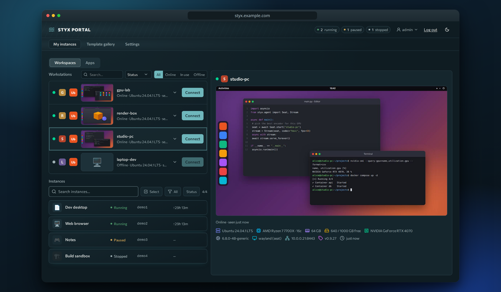

---
hide:
  - navigation
  - toc
---

# Styx Portal

!!! quote "Built on Selkies"
    [{ width="48" align=left }](https://github.com/selkies-project)
    Streaming in Styx is powered by the [Selkies Project](https://github.com/selkies-project):
    [selkies](https://github.com/selkies-project/selkies), [pixelflux](https://github.com/selkies-project/pixelflux)
    and [pcmflux](https://github.com/selkies-project/pcmflux), with desktop images from
    [LinuxServer.io](https://www.linuxserver.io/). We could not have built this without them; please
    [star and support Selkies](https://github.com/selkies-project/selkies). See [Acknowledgements](acknowledgements.md).

**Your machines and your apps, in a browser tab.** Launch containerized Linux desktops, stream physical workstations at low latency, and put your home-lab apps behind one sign-in.

[Get started](operate/install.md){ .md-button .md-button--primary }
[Use the portal](use/index.md){ .md-button }

## What it does

-   :lucide-monitor-play: **Stream workstations**

    Enroll a Linux machine with one command. AV1, HEVC or H.264 on the GPU, audio, clipboard and file transfer.

    [:octicons-arrow-right-24: Workstations](use/workstations.md)

-   :lucide-container: **Disposable desktops**

    Launch persistent containerized desktops from templates, with GPU passthrough and idle auto-stop.

    [:octicons-arrow-right-24: Desktops](use/desktops.md)

-   :lucide-layout-grid: **One front door for apps**

    Jellyfin, the \*arr stack, Nextcloud, Home Assistant behind one hostname, with SSO, groups and a framed shell.

    [:octicons-arrow-right-24: Apps](use/services.md)

-   :lucide-shield-check: **Built to be exposed carefully**

    Argon2id, sign-in cards, brute-force bans, cookie isolation, audit log, TLS pinning for agents.

    [:octicons-arrow-right-24: Security](operate/security.md)

-   :lucide-sliders-horizontal: **Admin from the UI**

    Users, groups, OIDC/OAuth2, live-tunable settings, health history.

    [:octicons-arrow-right-24: Settings reference](operate/settings.md)

-   :lucide-boxes: **Compose or Kubernetes**

    Docker Compose with Traefik and Cloudflare Tunnel, or Kustomize manifests for k3s.

    [:octicons-arrow-right-24: Install](operate/install.md)

## How it fits together

## Choose your path

-   **Use** :material-account:

    I have an account and want to get to my desktops, workstations and apps.

    [:octicons-arrow-right-24: Start with getting started](use/getting-started.md)

-   **Operate** :material-server:

    I run the portal: install, enroll machines, manage users, tune streaming.

    [:octicons-arrow-right-24: Start with install](operate/install.md)

-   **Build** :material-hammer-wrench:

    I want to understand or change the code: architecture, agent, testing, releases.

    [:octicons-arrow-right-24: Start with architecture](build/architecture.md)

## Quick links

- [Settings reference](operate/settings.md) · [Streaming tuning](operate/streaming-tuning.md) · [Troubleshooting](use/troubleshooting.md)
- [Decisions (ADRs)](decisions/index.md) · [Changelog](https://github.com/sgtslaughta/styx-portal/blob/main/CHANGELOG.md)
