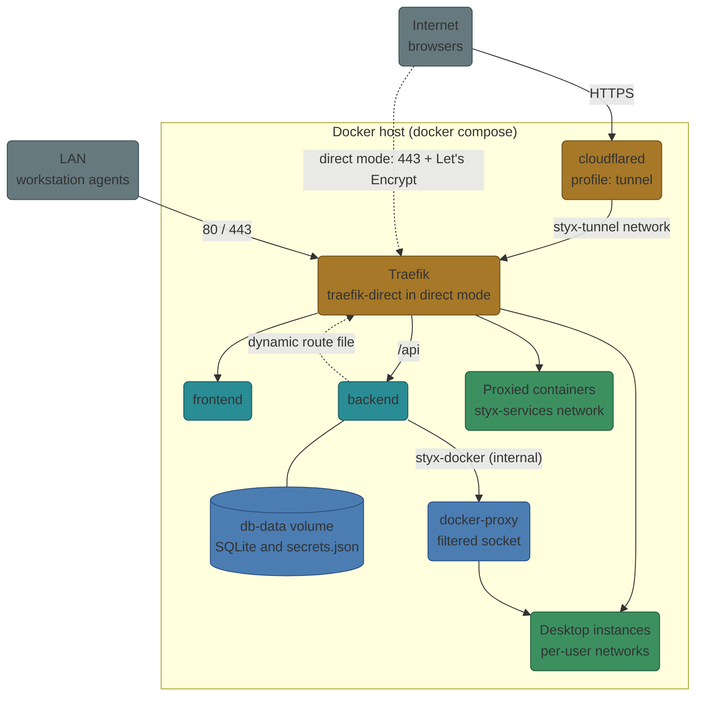

# Install with Docker Compose

You will have a working Styx portal and an admin account.

**Prerequisites**

- Docker and Docker Compose v2
- A domain name (for example `styx.example.com`)
- Default path: a [Cloudflare Tunnel token](https://developers.cloudflare.com/cloudflare-one/connections/connect-networks/) (free tier is fine). For Let's Encrypt on a static IP, see [Production](production.md#direct-mode-lets-encrypt-wildcard).

## Steps

1. **Clone and configure**

    ```bash
    git clone https://github.com/sgtslaughta/styx-portal.git
    cd styx-portal
    cp .env.example .env
    ```

2. **Edit `.env`**

    ```bash
    DOMAIN=styx.example.com
    CF_TUNNEL_TOKEN=<your-cloudflare-token>
    ```

    Leave `JWT_SECRET` empty. A strong secret is generated on first boot and saved to the data volume.

3. **Start**

    ```bash
    docker compose up -d
    ```

    `COMPOSE_PROFILES=tunnel` is the default, so Cloudflare Tunnel mode starts automatically. The `backend` and `frontend` images come from GHCR on each release; to pin a release set `STYX_TAG` in `.env` (for example `STYX_TAG=2.7.0`). To build from source use `docker compose up -d --build`. If the GHCR packages are private, run `docker login ghcr.io` first.

4. **Finish setup**

    Open `https://styx.example.com`. You are redirected to `/setup`. Enter the **setup code** (`docker compose logs backend | grep "setup code"`, or `docker compose exec backend cat data/setup-token`) and create the admin account. The **Environment Check** panel shows Docker, database and network status; green lights mean you are ready.

5. **Invite people.** In **Settings → Administration → Users**, press **Generate invite**.

## What gets deployed



## Planning for workstations

Physical workstations enroll over your LAN, not the tunnel. Uncomment the `ports:` block on the `traefik` service in `docker-compose.yml` (`80:80` and `443:443`) and set `SERVER_LAN_URL` in `.env` to the host's LAN address (for example `https://10.0.0.10`). The backend generates a self-signed certificate for that address and pins it in the enrollment command. See [Enroll workstations](workstations-enroll.md).

!!! warning "Back up your secrets"
    The auto-generated `JWT_SECRET` lives in the `db-data` volume at `/app/data/secrets.json` (mode 0600). Losing it logs everyone out, invalidates stored OAuth client secrets and makes sign-in cards unreadable.

    ```bash
    docker cp styx-backend:/app/data/secrets.json ./secrets.json.backup
    ```

!!! danger "Do not expose it bare"
    The portal is hardened but is not a fortress. Put it behind a Cloudflare Access application or another second layer if it faces the internet.

## Environment variables

Most day-to-day behaviour is in the [Settings reference](settings.md) and applies live. These deploy-time variables live in `.env`.

| Variable | Default | Purpose |
|---|---|---|
| `DOMAIN` | `portal.example.com` | Portal hostname |
| `COMPOSE_PROFILES` / `DEPLOY_MODE` | `tunnel` | `tunnel` (Cloudflare) or `direct` (Traefik + Let's Encrypt). Keep both equal |
| `CF_TUNNEL_TOKEN` | empty | Tunnel mode only |
| `LE_EMAIL`, `CF_DNS_API_TOKEN` | unset | Direct mode, DNS-01 wildcard certificates |
| `JWT_SECRET` | auto | Pin your own with `openssl rand -base64 48` |
| `COOKIE_SECURE` | `true` | `false` only for local plain-HTTP dev |
| `MAX_INSTANCES_PER_USER` | `3` | Seed for the live setting of the same name |
| `VIDEO_GID` / `RENDER_GID` | `44` / `992` | Host GIDs for GPU access ([GPU](gpu.md)) |
| `SERVER_LAN_URL` | auto | LAN address workstations use |
| `SERVER_CA_PIN` | auto | Override the TLS pin (`sha256:<hex>`) |
| `TRUSTED_PROXY_CIDRS` | loopback + backend's own networks | Who may vouch for client IP headers |
| `STYX_TUNNEL_SUBNET` | `172.31.254.0/28` | Subnet of the cloudflared-to-Traefik network |
| `REGISTRY`, `STYX_TAG` | `ghcr.io/jmo-labs`, `latest` | Image namespace and pinned tag |
| `OAUTH_REDIRECT_BASE` | `https://${DOMAIN}` | Override the OAuth redirect base |

Next: [Production](production.md).
