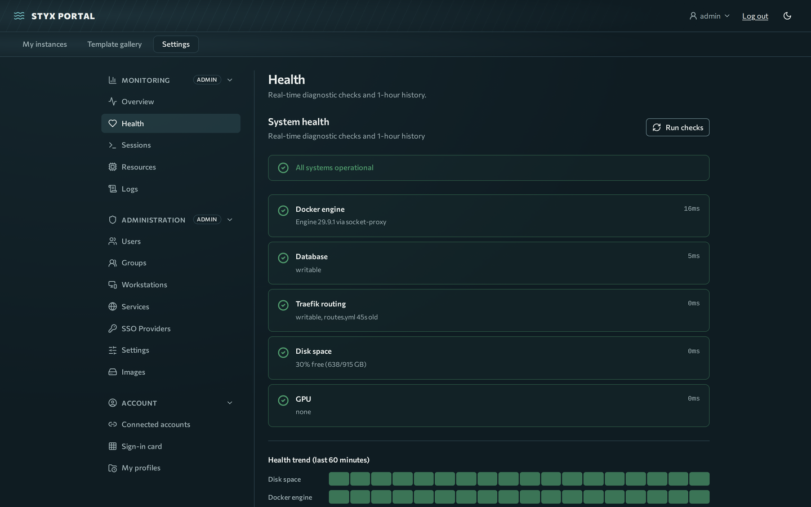

# Monitoring

Check that the portal is healthy and review what happened.

## Health page



**Settings → Monitoring → Health** shows each diagnostic check with latency and a remediation hint for failures: Docker engine (or Kubernetes) status and version, database writability, Traefik routes volume, disk usage and GPU availability. Press **Run checks** for an on-demand run. History is kept in memory at 60-second resolution, with 1 h, 6 h and 24 h views; it resets when the backend restarts.

API: `GET /api/system/diagnostics` (admin).

## Other Monitoring panels

| Panel | Shows |
|---|---|
| Overview | Aggregate CPU and RAM, instance counts, host info |
| Sessions | Running instances and lifecycle actions |
| Resources | CPU, memory, disk and GPU over time |
| Logs | Recent system and session events |

## Audit log

Security-relevant actions are recorded with time, user, IP and action: logins, logouts and refresh-token reuse; role changes, account linking and invites; OAuth provider changes; instance creation, deletion and overrides; DinD launches; mount applies; sign-in card resets.

There is no audit viewer in the UI yet. Use the API (admin session):

```bash
curl -b "access_token=<token>" "https://styx.example.com/api/audit?limit=50&offset=0&action=user.reset_password"
```

Query parameters: `limit` (max 500), `offset`, `action`, `user_id`.

## Kubernetes alerts

`deploy/k8s/prometheusrule.yaml` ships `StyxBackendDown` (critical), `StyxBackupFailed` and `StyxBackupStale`. See [Kubernetes](kubernetes.md#reliability).
