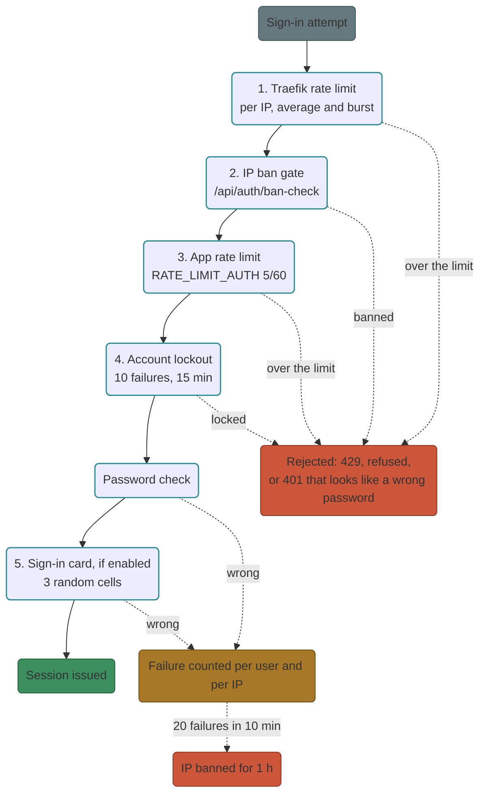

# Security

What protects the portal, what you can tune, and what you must still trust. Defaults are on; the knobs live in the [Settings reference](settings.md).

!!! danger "Not Fort Knox"
    Styx is hardened but young. Put it behind a second layer (for example a Cloudflare Access application) before exposing it to the internet, and report problems you find.

## Brute-force defence

Layers, outermost first:

1. **Proxy rate limit (Traefik):** average and burst requests per IP (`TRAEFIK_RATELIMIT_AVERAGE`, `TRAEFIK_RATELIMIT_BURST`; defaults 100 and 50).
2. **App rate limits:** `RATE_LIMIT_AUTH` (default `5/60` on login endpoints), `RATE_LIMIT_DEFAULT` (`120/60`), `RATE_LIMIT_INSTANCE_CREATE` (`10/3600` per user).
3. **Per-account lockout:** `LOCKOUT_THRESHOLD` failed logins per username (default 10) lock the account for `LOCKOUT_DURATION` seconds (default 900). Admins can **Unlock** early.
4. **Per-IP ban:** `BAN_FAIL_THRESHOLD` failures per IP within `BAN_FAIL_WINDOW` (default 20 in 600 s) ban the IP for `BAN_DURATION` (default 3600 s). Traefik's `ip-ban-gate` calls `/ban-check` on every request, including proxied services and workstations.

A wrong current password on **Change password** counts as a failed sign-in.

## Authentication

- Native JWT sessions with Argon2id password hashing, CSRF (double-submit) and refresh-token rotation with family-based reuse detection (RFC 9700). Presenting a revoked token invalidates the whole family and writes an audit event.
- Password policy: minimum length (default 12) and optional upper, lower, digit and symbol requirements ([Settings](settings.md#password-policy)).
- Optional **sign-in card** second factor, and SSO ([Users, groups and SSO](users-groups-sso.md)).
- Tokens: access token 15 minutes, refresh token 7 days by default ([Sessions & tokens](settings.md#sessions-tokens)).

## Cookies

| Cookie | Path | Accepted by |
|---|---|---|
| `access_token` | `/api` | API only |
| `refresh_token` | `/api/auth` | refresh and logout only |
| `styx_proxy` | `/` | forwardAuth only; the API refuses it |
| `csrf_token` | `/` | double-submit check (not a credential) |
| `styx_svc` | `/` | routing selector for focus apps (not a credential) |

`styx_proxy` is bound to the session's refresh-token family: logout, reuse detection, password change and admin reset or deactivation all invalidate it. Styx strips its own cookies (`styx_proxy`, `access_token`, `refresh_token`, `csrf_token`, `styx_svc`) from every request forwarded to a proxied app, so upstreams never see Styx credentials. App cookies pass through.

## Access gates

- **Instances** (`/i/<subdomain>/`): per-instance forwardAuth; valid `styx_proxy` cookie and the owner or an admin. Anonymous navigations go to `/login?next=...`, others get 403, stopped instances show an unavailable page.
- **Workstations** (`/w/<subdomain>/`): forwardAuth checks the user's access. The Selkies basic-auth password is injected by Traefik server-side and never reaches the browser.
- **Services:** per-service forwardAuth by group, with optional bypass rules ([Proxied services](services.md#auth-modes)).
- **Internal paths** (`/internal/...`) are not exposed by any Traefik router.
- **Safe `next=`:** login redirects only follow same-site paths that do not start with `api`, `internal`, `_styx`, `login`, `logout`, `setup`, `accept-invite` or `change-password` and contain no encoded dots or slashes.

## Isolation

- Docker socket-proxy (POST allowed for create/start/archive/network; exec, build, system blocked).
- Instances: `cap_drop: ["ALL"]` plus minimal `cap_add`; per-user bridge networks `styx-u-{user_id}`; DinD only for admins with limits.
- Proxied containers join the `styx-services` network, shared only with Traefik; they cannot reach the API or the socket proxy.
- Screenshot browser jail: the thumbnail Chromium can reach only the instance's own `ip:port`.
- Outbound fetch policy: health and favicon fetches refuse loopback, link-local and metadata addresses and Styx internals; DNS is resolved once and pinned (no rebinding). RFC1918 LAN targets stay allowed.
- Browser headers: CSP, HSTS (this host only), `X-Frame-Options`, `X-Content-Type-Options`; `X-Frame-Options: SAMEORIGIN` is forced on service routes.
- No API docs or server banners unless `ENABLE_DOCS=true`.

## Client IPs

The backend believes `CF-Connecting-IP` / `X-Forwarded-For` only when the socket peer is in `TRUSTED_PROXY_CIDRS` (default loopback plus the subnets of the backend's own interfaces at startup). `CF-Connecting-IP` is ignored in direct mode, and in tunnel mode unless the peer Traefik saw is in `TUNNEL_PEER_CIDRS`.

## Proxied apps are trusted code

The cookie split stops an upstream **server** from stealing credentials, but a proxied app's **JavaScript** runs on the Styx origin and can call `/api/...` through the browser with the viewing user's rights.

- Only proxy apps you would trust with that user's Styx account.
- Admins should use a separate non-admin account for daily app use.
- While a focus app is active, `/api` writes are refused (403) except `auth/refresh`, `auth/logout`, `auth/me/preferences` and `services/focus*`; admin writes from a browser must be a fetch with a Styx-page Referer. Known bypasses exist (a hostile focus app can clear its own cookie or frame `/_styx/exit`), so the real ceiling stays: untrusted apps get member accounts, not admin accounts.
- Turning **Verify upstream TLS** off lets anyone on your LAN intercept traffic to that host; use it only for self-signed appliances.

## Workstation trust

- Single-use enrollment tokens (default 1 hour), a unique hashed per-workstation bearer token, and automatic TLS pinning of the LAN certificate.
- Revocation takes effect at the next agent heartbeat (about 30 s). Instance streams have no kick channel: a revoked user keeps an already-open websocket until it closes; stop the instance to cut it.
