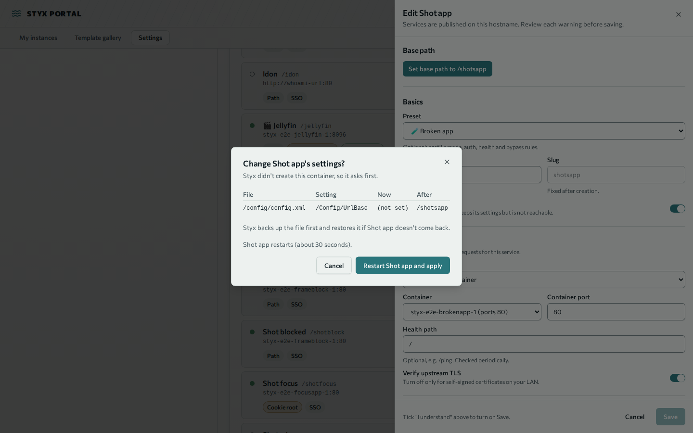
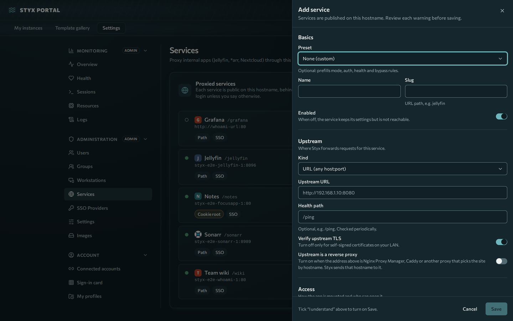
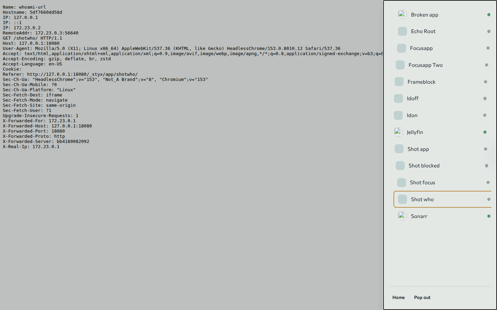

# Proxied services

You will put internal apps behind the portal's single hostname with SSO and group access. For the end-user view see [Use: Apps and the shell](../use/services.md).

**Prerequisites:** admin rights; for Docker discovery, the Styx host must run the app's container (not available for container discovery on Kubernetes, see [Kubernetes](kubernetes.md)).

Styx can proxy any internal HTTP service (Jellyfin, the *arr stack, Nextcloud, GitLab,
Unraid, Audiobookshelf, anything at `ip:port`) through the single Styx hostname.
Admins add services under **Settings → Administration → Services**; users see tiles
on the home page for the services their groups allow.

## One hostname, two mount modes

- **Path** (`https://<host>/<slug>`): the app must be configured with that base URL
  (each preset shows the exact setting). Works in browsers and mobile apps. The Traefik
  rule is `Path(/slug) || PathPrefix(/slug/)`, so a slug never captures a sibling prefix
  (`son` does not match `/sonarr`).
- **Cookie root** (shown as **Focus** in the UI): for apps with no base-URL support. Clicking the tile sets a routing
  cookie (`styx_svc`) and the app takes over `/` for that browser, including `/login`.
  One cookie-root service at a time; mobile apps cannot use this mode. To get back to
  Styx, open `https://<host>/_styx/exit`.

Slugs are validated on create/update. Reserved: `api i w assets login setup connecting
change-password accept-invite _styx`, plus Authentik paths (`if application
outpost.goauthentik.io static media flows ws - .well-known source`).

## Auth modes

| mode | who can reach it | use for |
|---|---|---|
| `sso` | logged-in Styx users in the allowed groups | browser-only apps |
| `sso-with-bypass` | as above, plus unauthenticated requests matching a bypass rule | apps with mobile clients / API keys |
| `app-native` | anyone on the internet; the app enforces its own login | apps with their own SSO |

### How a request is decided


### Bypass rules

A rule is a path prefix plus an optional required header name. A request bypasses Styx
login only when the normalised path matches the prefix on a **segment boundary**
(`/sonarr/api` matches `/sonarr/api/v3` but not `/sonarr/apix`) and, if set, the header is
present (any value). Requests containing `..` segments, backslashes or encoded `.`, `/`
or `\` (raw or decoded) are never eligible for bypass.

The header check only filters scanners: anyone can add a header. Only the app's own
credential (API key, token) protects bypassed requests.

## Groups

Create groups under Settings → Administration → Groups, assign users, then pick allowed groups on a
service by **name**. Empty allowed-groups means every logged-in user. Admins can always
open everything. Unknown group names are rejected (422). Deleting a group removes it from
every service; a service left with no groups is **disabled** (fail closed, since an empty
list would otherwise mean "any user").

## Discovery and health

"Add from running container" lists running containers on the Styx host (excluding Styx's own stack
and launched instances). Adding one attaches it to the `styx-services` network
(`SERVICES_NETWORK`), which only Traefik shares; the backend and frontend are not on it.
If attaching fails (e.g. `network_mode: host`), Styx falls back to
`host.docker.internal:<port>` and shows a *fallback* badge (the port must be published on
the host). Changing or deleting the service disconnects the container unless another
service still uses it.

Health dots:

- **docker-local**: from Docker container state. Running is healthy unless a Docker
  `HEALTHCHECK` says otherwise (`starting` shows unknown); stopped or missing is unhealthy;
  Docker unreachable is unknown.
- **URL services**: an HTTP probe of `health_path` every 30 s (5 s timeout, honours
  verify-TLS, redirects are not followed). 2xx/3xx is healthy. Link-local and cloud
  metadata targets (e.g. `169.254.169.254`) are refused.

Unhealthy tiles stay clickable.

## Apps behind a reverse proxy

Some URL services are not the app itself but a proxy in front of it, such as Nginx Proxy
Manager, Caddy or another Traefik. These pick the site by hostname, so when Styx reaches them
with Styx's own name they reset the connection (`tlsv1 unrecognized name`) or show a default
page. Set the service's upstream address to the hostname the proxy knows the app by (for
example `https://unraid.home.lan`; an IP address is not accepted). **Upstream is a reverse
proxy** turns on by itself when the address uses a hostname (off for IPs and `localhost`); you
can switch it off. Without it, nginx-based proxies answer `421 Misdirected Request`. Styx then sends that hostname as the `Host` header and TLS SNI, for both
traffic and the health and icon checks. `X-Forwarded-Host` still carries the Styx name.
With TLS verification on, the certificate is checked against that hostname.

Redirects: the app now believes its address is that hostname, so it may answer with an absolute
redirect (`Location: https://unraid.home.lan/login`). Styx rewrites redirects (`Location`, and
`Refresh: N; url=...`) that point at the proxy hostname back to Styx-relative paths, so the browser
stays inside Styx. This uses a Traefik local plugin shipped in `traefik/plugins-local`, mounted
into the Traefik container at `/plugins-local`.

Limit: absolute links the app writes into its pages or JavaScript with its own hostname are not
rewritten (Styx never edits response bodies), so those still leave Styx and only work where the
name resolves. Prefer connecting Styx straight to the app when you can.

## Presets

Defined in `templates/services/*.json` and seeded on startup. Sonarr, Radarr, Prowlarr,
Lidarr and Jellyfin are configured by Styx (see above); the base URL column is what Styx
sets, or what you set by hand for the rest.

| preset | mount | auth | base URL setting |
|---|---|---|---|
| Sonarr | path | sso-with-bypass (`/sonarr/api` + `X-Api-Key`) | Settings → General → URL Base = `/sonarr` |
| Radarr | path | sso-with-bypass (`/radarr/api` + `X-Api-Key`) | URL Base = `/radarr` |
| Prowlarr | path | sso-with-bypass (`/prowlarr/api` + `X-Api-Key`) | URL Base = `/prowlarr` |
| Lidarr | path | sso-with-bypass (`/lidarr/api` + `X-Api-Key`) | URL Base = `/lidarr` |
| Jellyfin | path | sso; **Allow native apps** adds the bypass rules in [Native apps](#native-apps) | set by Styx (Dashboard → Networking → Base URL = `/jellyfin`) |
| Nextcloud | path | sso | `config.php`: `overwritewebroot` = `/nextcloud`, `overwrite.cli.url` = `https://<host>/nextcloud` |
| GitLab | path | sso | `gitlab.rb`: `external_url 'https://<host>/gitlab'`, then reconfigure. CLI git over HTTPS will not pass SSO; use SSH remotes |
| Audiobookshelf | cookie-root | sso-with-bypass (`/api/` + `Authorization`) | none (no subpath support) |
| Unraid | cookie-root | sso, verify TLS off | none (self-signed certificate) |
| Home Assistant | cookie-root | sso | none (runs at the root only) |
| Immich | cookie-root | sso | none (runs at the root only) |
| Generic HTTP | path | sso | set the app's base URL to `/<slug>`, or use cookie-root |

## How apps are mounted

Every service has a mount mode. The preset picks it; admins can change it under
**Advanced** in the service form.

| Mode | URL | Who sets the app's base path | Examples |
|---|---|---|---|
| Path, configured by Styx | `https://<host>/<slug>` | Styx writes it into the app's settings file | Sonarr, Radarr, Lidarr, Prowlarr, Jellyfin |
| Path, set by you | `https://<host>/<slug>` | You, in the app (the preset shows where) | Nextcloud, GitLab, Generic HTTP, anything added by URL |
| Focus | `https://<host>/` (the app takes over the root) | Nothing to set, the app needs no base path | Home Assistant, Immich, Audiobookshelf, Unraid |

The service form shows the choice as a line under **Access**, for example
"Path /sonarr, configured by Styx", "Path /nextcloud, set the app's base path
yourself" or "Focus: opens full screen". Styx can only configure docker-local
services whose preset has a `subpath` block. In the database, focus is still
`cookie-root`.

## Letting Styx configure an app

For a docker-local service in path mode, the drawer has a **Base path** section.
It shows one of:

- **Set base path to /\<slug\>**: the app's setting differs from the slug.
- "Base path is set to /\<slug\>": nothing to do.
- A reason and no button: Styx can't reach the settings file (for example it sits on a
  tmpfs mount). You can set the base path yourself or pick a preset.

Pressing the button runs a job with four steps: **Back up settings**, **Apply base
path**, **Restart app**, **Check the app responds**. The stepper updates while it runs.





### Consent

If Styx created the container (it carries the `styx.managed=true` label), the job starts
at once. For any other container, such as one added with "Add from running container", Styx asks
first. The dialog "Change \<app\>'s settings?" lists every change as file, setting,
now and after, and says that the app restarts (about 30 seconds). Choose **Restart
\<app\> and apply** to continue or **Cancel**. Without consent the API answers 409.
Consent is written to the audit log with the admin and the change list.

### Backups and rollback

Before writing, Styx copies the settings file to
`data/mount-backups/<service-id>/<UTC timestamp>/<file name>` in the backend data volume
(`/app/data/mount-backups` in the container). The last 5 backups per service are kept.
`<service-id>` is the service's internal id, not its slug.

After the restart, Styx checks that the app answers at its new path for up to 90
seconds. The check runs from a short-lived `busybox` container on the services network
(`MOUNT_PROBE_IMAGE`, default `busybox:1.36`), because the backend is not on that
network. The probe runs as an unprivileged user with no capabilities; pin
`MOUNT_PROBE_IMAGE` to a digest (`busybox@sha256:...`) so a moved tag can't change what runs.
If the change, restart or check fails, Styx restores the backup, restarts the
app and checks the old path. The job then ends as rolled back and the drawer shows:

- the reason and the app's last log lines under **App log**;
- **Try again**, which re-runs the job;
- **Use focus mode instead**, which switches the service to focus mode.

If the rollback fails too, the drawer says so and gives the backup folder. A backend
restart during a job marks the job failed and keeps the backup.

Special cases:

- A settings file that is a single-file bind mount can't be replaced. The job fails with
  "This settings file is mounted on its own, so Styx can't replace it" and nothing is
  written or restored. Mount the file's folder instead, or set the base path by hand.
- A fresh Jellyfin has no `network.xml` yet. Styx creates a minimal one (the consent dialog
  shows it as a new file). For other apps whose settings file is missing, the drawer shows
  the app's hint, for example saving the app's settings once.
- Switching a service to focus or manual later does not undo the app's base path. Styx
  has no revert button.

### Restoring a backup by hand

```bash
docker exec styx-backend ls /app/data/mount-backups/<service-id>/
docker cp styx-backend:/app/data/mount-backups/<service-id>/<timestamp>/config.xml .
docker cp config.xml <app-container>:/config/config.xml   # path the consent dialog showed
docker restart <app-container>
```

Use the container names from `docker ps`. The file name inside a backup folder is the
settings file's name, for example `config.xml` or `network.xml`.

## Focus apps

Home Assistant, Immich and other root-only apps run in focus mode.

- Opening a focus app sets a routing cookie and the app takes over `/` for that
  browser. Only one focus app is active per browser; opening another replaces it.
  Other browsers and devices are not affected.
- Tiles for focus apps say "Opens full screen". The active one shows **Exit**.
- Open links go through `/_styx/open/<slug>`. If the request is not clearly from Styx
  itself (a cross-site link, or a browser that sends no `Sec-Fetch-Site`), Styx shows an
  "Open app?" confirm page instead of switching, so another site can't change your
  focused app.
- Leaving: the dock's **Home** and **Exit focus**, or open `/_styx/exit` (optionally
  `?next=<path>`). Both clear the cookie.
- Before a focus app loads in the shell, Styx unregisters service workers registered
  for `/`, so the previous app's worker can't answer for the new one. Opening an app
  also clears the browser cache for the site (`Clear-Site-Data: "cache"`); logins kept
  in local storage survive.
- Stale tabs: while a focus app is active, reloading `/` in another Styx tab shows the
  focus app, not Styx. Use Home or `/_styx/exit` to get back.

## The Styx shell and dock

Home tiles open `/_styx/app/<slug>/`. The shell is a full-window frame around the app,
served from the same origin, plus a small dock. Address and page title follow the app,
so reloads and deep links work. Services with **Open without overlay** (Advanced) skip
the shell and open the bare app.



- **Edge tab**: a handle on the screen edge. Click or tap it to open the dock. Drag it
  anywhere along the edge; it snaps to the left or right side and remembers its place on
  that device. It fades when idle.
- **Alt+Shift+S** toggles the dock, also while focus is inside the app. **Esc** closes
  it, also when typed inside the app.
- The dock lists your apps with health dots; the current one is ringed. Picking an app
  switches to it. The actions are **Home**, **Pop out** (the bare app in a new tab) and,
  for a focus app, **Exit focus**.
- Some apps refuse to be framed (a `frame-ancestors` policy). The shell detects this
  and shows "\<app\> can't run inside Styx" with **Open \<app\> on its own**. Turn on
  **Open without overlay** for that service so its tile skips the shell.
- Styx forces `X-Frame-Options: SAMEORIGIN` on service routes, so other sites can't
  frame your apps.

## Native apps

A browser can sign in through Styx, but a phone app can't. **Allow native apps** (service
form, **Access**, presets that support it) switches the service to `sso-with-bypass` with
the preset's rules. For Jellyfin a request skips Styx login when its path starts with
`/jellyfin/` and it has one of:

- an `Authorization` header starting with `MediaBrowser`;
- an `X-Emby-Authorization` header starting with `MediaBrowser`;
- an `X-Emby-Token` or `X-MediaBrowser-Token` header;
- an `api_key` query parameter (used by cast and stream URLs).

The risk: Jellyfin's own login is exposed to the internet. Anyone who can guess
a header can reach it, and only Jellyfin's credentials and Styx rate limits and IP bans
protect it. It is off by default and the form shows a red callout when it is on.

To test with the Jellyfin app, enter `https://<domain>/jellyfin` as the server address
after Styx has set the base path. Turn the option off and sign-in should fail.

## Pass identity

**Pass identity** (service form, **Access**, off by default) sends the signed-in user to
the app as `X-Styx-User`, `X-Styx-Email` and `X-Styx-Groups`. Without it the app
receives none of them. Copies sent by clients are always removed. Only turn it on for
apps that use these headers to sign people in:

- Grafana: `[auth.proxy]` with `enabled = true`, `header_name = X-Styx-User`,
  `header_property = username`, `auto_sign_up = true`.
- Paperless-ngx: `PAPERLESS_ENABLE_HTTP_REMOTE_USER=true` and
  `PAPERLESS_HTTP_REMOTE_USER_HEADER_NAME=HTTP_X_STYX_USER`.

An app that trusts these headers must not be reachable except through Styx.

## Security model

Every service is reachable from the internet through Cloudflare → Traefik → Styx.
Read this section before exposing anything.

- Rate limiting and IP banning (`styx-ratelimit`, `ip-ban-gate`) apply to every service route.
- Identity headers (`X-Styx-*`, `X-authentik-*`) are stripped from client requests.
- **Bypass rules are the only unauthenticated surface** (see above), plus `app-native`
  services, where Styx does no authentication at all. **Allow native apps** is a set of
  bypass rules and is off by default.
- **Mount changes need consent and are audited.** Styx writes into a container only
  through the Docker archive API, only to paths the preset declares, and asks an admin
  first for containers it didn't create. Each apply is logged with the change list. A
  backup is taken first and restored on failure.
- **Frames are same-origin only.** `X-Frame-Options: SAMEORIGIN` is forced on service
  routes.
- **Identity is opt-in.** `X-Styx-*` headers reach an app only with **Pass identity**.
- **Verify upstream TLS off** means traffic between Styx and that host can be intercepted
  on your LAN. Use it only for self-signed appliances such as Unraid.
- The cookie-root routing cookie is a selector, not a credential: access is checked on
  every request.
- **Access checks are internal.** forwardAuth calls
  `/internal/services/<slug>/auth-check` (and `/internal/workstations/<id>/auth-check`, `/internal/instances/<id>/auth-check`), paths
  no Traefik router exposes. They authenticate only with the `styx_proxy` cookie.
- **Network isolation.** Proxied containers sit on `styx-services` with Traefik only, so
  they cannot reach the Styx API or the Docker socket proxy.
- **Client IPs** (rate limits, bans, audit) come from `CF-Connecting-IP` /
  `X-Forwarded-For` only when the socket peer is in `TRUSTED_PROXY_CIDRS` (default:
  loopback plus Docker's default bridge pools `172.16.0.0/12`; widen it if
  `daemon.json` sets other pools). `CF-Connecting-IP` is ignored when
  `DEPLOY_MODE=direct`, and in tunnel mode unless the peer Traefik saw is in
  `TUNNEL_PEER_CIDRS` (default: the `styx-tunnel` subnet shared only by cloudflared and Traefik).
- **Identity headers.** Spoofed spellings (`X_Styx_User`, mixed `-`/`_`, `Remote-User`,
  `X-Forwarded-User`, ...) are removed by Traefik; the forwardAuth handlers return 400 for
  any that still arrive disguised.

### Cookie split

Proxied apps share the Styx origin, so Styx scopes its cookies to keep API tokens away
from them:

| Cookie | Path | Accepted by |
|---|---|---|
| `access_token` | `/api` | API only |
| `refresh_token` | `/api/auth` | refresh and logout only |
| `styx_proxy` | `/` | forwardAuth only; refused by the API |
| `csrf_token` | `/` | double-submit check (not a credential) |

`styx_proxy` is bound to the session's refresh-token family, so logout, refresh-reuse
detection, password change and admin reset or deactivation all invalidate it. Styx
strips its own cookies from every request it forwards to a proxied app, so upstreams
never see Styx credentials.

### Same-origin warning

JavaScript served by a proxied app runs on the Styx origin. It cannot read the HttpOnly
tokens, but it can make same-origin `fetch('/api/...')` calls that the browser sends with
the user's `/api` cookies, so it can act with the **viewing user's Styx rights**.
Treat every proxied app as trusted code. Admins should use a non-admin account for daily
app use. The service form requires you to acknowledge this. A full fix needs per-service
origins (subdomains), which is out of scope for now.

## Running the end-to-end suite

`e2e/` holds an isolated full-stack Playwright suite for proxied services: Traefik,
backend and frontend built from this checkout, plus two `traefik/whoami` upstreams (one
docker-local, found through "Add from running container"; one reached by URL). whoami echoes the
request headers, which lets the suite prove that Styx cookies never reach an upstream.

```bash
e2e/run.sh                     # build, start, test, always `down -v`
e2e/run.sh -g "cookie-root"    # any Playwright args pass through
KEEP=1 e2e/run.sh              # leave the stack up for debugging
```

Requirements: Docker with Compose v2, Node 20+. The script installs the pinned
`@playwright/test` and Chromium on first run.

- Compose project `styx-e2e` (`e2e/compose.yml`), fresh tmpfs database each run, no
  fixed container names. The only published port is `127.0.0.1:18080` (Traefik, plain
  HTTP, `COOKIE_SECURE=false`, `DOMAIN=127.0.0.1`).
- The backend reaches Docker only through `e2e/docker-shim`, which narrows discovery to
  containers labelled `styx-e2e.discoverable=true` and refuses every write except
  create/connect/disconnect on `styx-e2e-services` for containers of this project. The
  backend's hardcoded `styx-traefik` (the live stack's Traefik) is rewritten to the e2e
  Traefik, so the suite can run next to a live stack without touching it.
- The admin is created through the real `/setup` page and users through invite links.
- Screenshots of every services/groups screen (light and dark, 1440x900 and 390x844)
  land in `e2e/screenshots/` (gitignored). More on the test tiers is in [Build: Testing](../build/testing.md).

### Trust and same-origin apps

What Styx does about it, and where it stops:

- While a Focus app is active (valid `styx_svc` cookie), `/api` writes are refused (403)
  except `auth/refresh`, `auth/logout`, `auth/me/preferences` and `services/focus*`. The
  shell only needs those plus reads.
- Admin writes from a browser must be a `fetch` (`Sec-Fetch-Dest: empty`) whose Referer is
  a Styx page, not `/<slug>/...`, `/i/...`, `/w/...` or `/_styx/app`. With no Referer, the
  a missing Referer is refused too (a page script can suppress it). Clients that send no
  `Sec-Fetch-Dest` (curl, scripts) keep working with CSRF. Focus app pages live at root
  paths, so their Referer looks like a Styx page; the Focus write guard above covers them.
- OAuth callbacks (`/api/auth/oauth/`, `/api/auth/link/`, `/api/oauth-providers/`) and
  `/accept-invite` always reach Styx, never a Focus app.
- Known bypasses of the Focus write guard: a hostile Focus app can clear its own `styx_svc`
  cookie (Set-Cookie from its upstream) or frame `/_styx/exit`; its pages then send a
  root-path Referer, which passes the origin check. A path-mounted app can fake an SPA
  Referer with `history.replaceState`. Styx does not strip upstream Set-Cookie headers.
  The origin check now covers every write made by an admin account, not only admin routes.

The ceiling: any proxied app can still act as its viewer for member-level calls. Open
untrusted apps with a member account, not an admin account.
