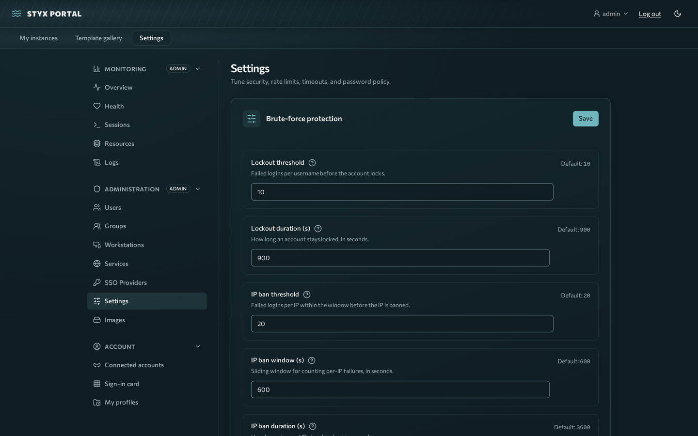

# Settings reference

Every admin setting, generated from `backend/app/services/settings_store.py`. All of them apply **live** with no restart.

**Where:** **Settings → Administration → Settings**. Settings are grouped; edit values and press the group's **Save**. A row's reset action returns it to the default.

**How they work**

- A setting's **default** is seeded from the matching environment variable (same name, for example `LOCKOUT_THRESHOLD`) or the built-in value. Saving a value stores an override in the database; **reset** removes the override.
- Values are validated server-side: integers must be within the range shown, switches are on/off, rate limits are written `requests/seconds` (for example `5/60` is 5 requests per 60 seconds).
- Changing `TRAEFIK_RATELIMIT_AVERAGE` or `TRAEFIK_RATELIMIT_BURST` also rewrites the Traefik routes immediately.
- API: `GET/PATCH /api/system/settings` and `POST /api/system/settings/{key}/reset` (admin).

### Brute-force protection

| Key | Label | Default | Range | Effect |
|---|---|---|---|---|
| `LOCKOUT_THRESHOLD` | Lockout threshold | `10` | 1–100 | Failed logins per username before the account locks. |
| `LOCKOUT_DURATION` | Lockout duration (s) | `900` | 30–86400 | How long an account stays locked, in seconds. |
| `BAN_FAIL_THRESHOLD` | IP ban threshold | `20` | 1–1000 | Failed logins per IP within the window before the IP is banned. |
| `BAN_FAIL_WINDOW` | IP ban window (s) | `600` | 30–86400 | Sliding window for counting per-IP failures, in seconds. |
| `BAN_DURATION` | IP ban duration (s) | `3600` | 60–604800 | How long a banned IP stays blocked, in seconds. |

### Rate limits

| Key | Label | Default | Range | Effect |
|---|---|---|---|---|
| `RATE_LIMIT_AUTH` | Auth rate limit | `5/60` | `N/seconds`, e.g. `5/60` | Requests/seconds for login endpoints, e.g. 5/60. |
| `RATE_LIMIT_DEFAULT` | Default rate limit | `120/60` | `N/seconds`, e.g. `5/60` | Requests/seconds for all other endpoints, e.g. 120/60. |
| `RATE_LIMIT_INSTANCE_CREATE` | Instance-create rate limit | `10/3600` | `N/seconds`, e.g. `5/60` | Requests/seconds for instance creation per user, e.g. 10/3600. |
| `TRAEFIK_RATELIMIT_AVERAGE` | Proxy avg req/s | `100` | 1–100000 | Traefik average requests/second per IP. |
| `TRAEFIK_RATELIMIT_BURST` | Proxy burst | `50` | 1–100000 | Traefik burst per IP. |

### Sessions & tokens {#sessions-tokens}

| Key | Label | Default | Range | Effect |
|---|---|---|---|---|
| `ACCESS_TTL` | Access token TTL (s) | `900` | 60–86400 | Lifetime of access tokens, in seconds. |
| `REFRESH_TTL` | Refresh token TTL (s) | `604800` | 300–2592000 | Lifetime of refresh tokens, in seconds. |
| `MATRIX_SESSION_MAX_HOURS` | Card session max age (h) | `12` | 1–168 | Absolute lifetime of a sign-in-card (session-only) login, in hours. |

### Timeouts

| Key | Label | Default | Range | Effect |
|---|---|---|---|---|
| `WORKSTATION_IDLE_TIMEOUT_S` | Workstation idle timeout (s) | `900` | 60–86400 | Disconnect an idle physical-workstation stream after this many seconds. |
| `WORKSTATION_IDLE_WARN_LEAD_S` | Workstation idle warning lead (s) | `60` | 5–3600 | Seconds before idle disconnect to show the client countdown warning. Clamped below half the idle timeout. |
| `WORKSTATION_IDLE_TIMEOUT_ENABLED` | Workstation idle timeout enabled | on | on / off | Master switch for workstation idle timeout. Off ⇒ seats never time out (no client warning and no server disconnect). |
| `WORKSTATION_OFFLINE_AFTER_S` | Workstation offline-after (s) | `90` | 30–3600 | Mark a workstation offline after this many seconds without a heartbeat. |

### Workstation features

| Key | Label | Default | Range | Effect |
|---|---|---|---|---|
| `WORKSTATION_SEAT_WIDTH` | Seat width (px) | `2560` | 800–7680 | Default headless GNOME seat width. |
| `WORKSTATION_SEAT_HEIGHT` | Seat height (px) | `1440` | 600–4320 | Default headless GNOME seat height. |

### Quotas {#quotas}

| Key | Label | Default | Range | Effect |
|---|---|---|---|---|
| `MAX_INSTANCES_PER_USER` | Max instances per user | `3` | 0–1000 | Per-user instance cap; 0 = unlimited. Admins are exempt. |

### Password policy {#password-policy}

| Key | Label | Default | Range | Effect |
|---|---|---|---|---|
| `PASSWORD_MIN_LENGTH` | Minimum length | `12` | 8–256 | Minimum password length. |
| `PASSWORD_REQUIRE_UPPER` | Require uppercase | off | on / off | Require at least one uppercase letter. |
| `PASSWORD_REQUIRE_LOWER` | Require lowercase | off | on / off | Require at least one lowercase letter. |
| `PASSWORD_REQUIRE_DIGIT` | Require digit | off | on / off | Require at least one digit. |
| `PASSWORD_REQUIRE_SYMBOL` | Require symbol | off | on / off | Require at least one non-alphanumeric symbol. |

## Per-workstation overrides

Three timeouts and two seat sizes can also be overridden per workstation (keys in the workstation's stream settings), which win over the system values above:

| Workstation key | Overrides |
|---|---|
| `idle_timeout_s` | `WORKSTATION_IDLE_TIMEOUT_S` |
| `idle_warn_lead_s` | `WORKSTATION_IDLE_WARN_LEAD_S` |
| `idle_timeout_enabled` | `WORKSTATION_IDLE_TIMEOUT_ENABLED` |
| `seat_width`, `seat_height` | `WORKSTATION_SEAT_WIDTH`, `WORKSTATION_SEAT_HEIGHT` |
| `seat_shell` (`gnome` or `labwc`, default `gnome`) | no system equivalent |

Framerate, bitrate, CRF and the other encoder options are per workstation only; see [Streaming tuning](streaming-tuning.md). Seat sizes apply only before the first viewer connects: afterwards the seat follows the viewer's browser window.

## Deploy-time variables that are not live

These need a restart of the backend (or a redeploy). They are documented where they matter.

| Variable | Default | See |
|---|---|---|
| `WORKSTATION_HEARTBEAT_S` | `30` | [Enroll workstations](workstations-enroll.md#configuration) |
| `WORKSTATION_DEFAULT_PORT` | `8443` | same |
| `ENROLL_TOKEN_TTL_HOURS` | `1` | same |
| `SERVER_LAN_URL`, `SERVER_CA_PIN` | auto | same |
| `ARTIFACT_CACHE_DIR`, `AGENT_DIR` | `/app/data/artifacts`, `/app/agent` | same |
| `SCREENSHOT_INTERVAL_SECONDS` | `30` | thumbnails refresh interval |
| `MOUNT_PROBE_IMAGE` | `busybox:1.36` | [Proxied services](services.md#backups-and-rollback) |
| `DOMAIN`, `DEPLOY_MODE`, `COOKIE_SECURE`, `TRUSTED_PROXY_CIDRS`, `TUNNEL_PEER_CIDRS`, `JWT_SECRET` | see [Install](install.md#environment-variables) | |
| `ROUTE_BACKEND`, `K8S_*`, `INSTANCE_*` | `file`, ... | [Kubernetes](kubernetes.md) |
| `ENABLE_DOCS`, `DEV_CORS` | `false` | dev only |
