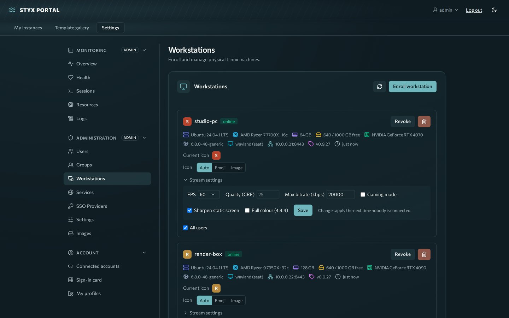
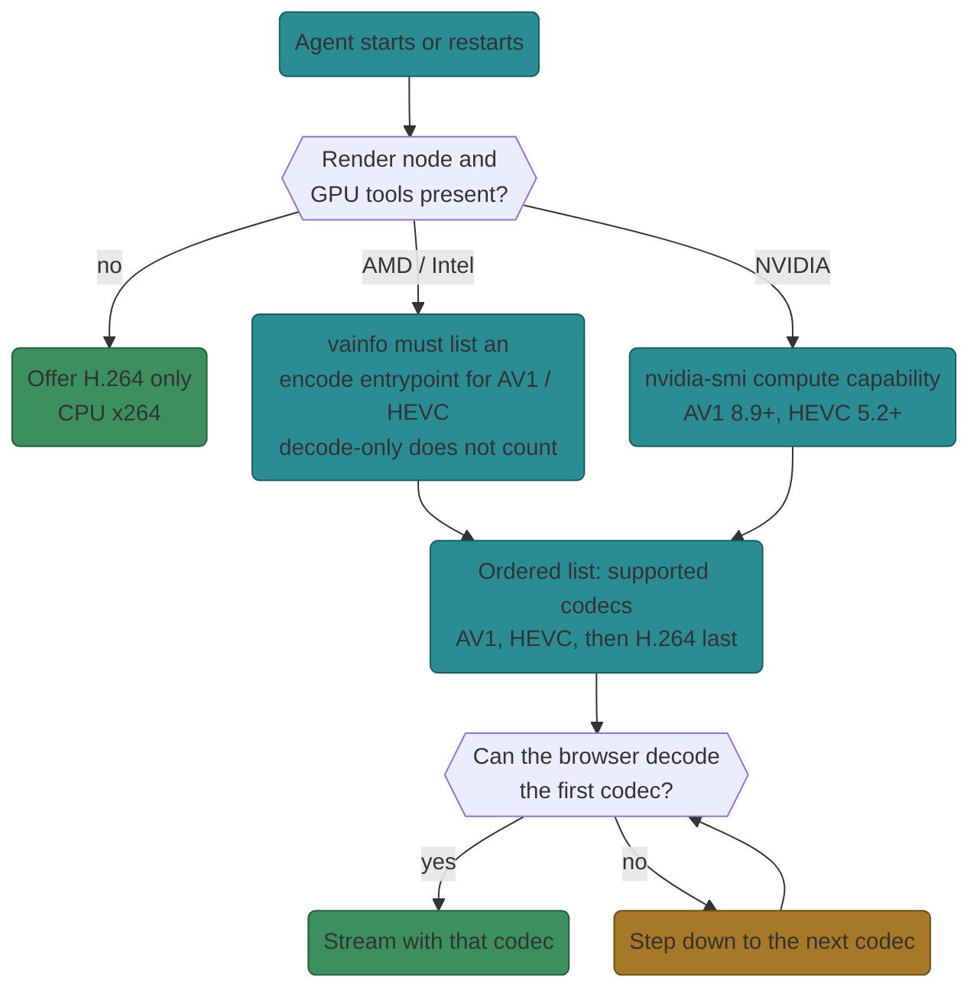
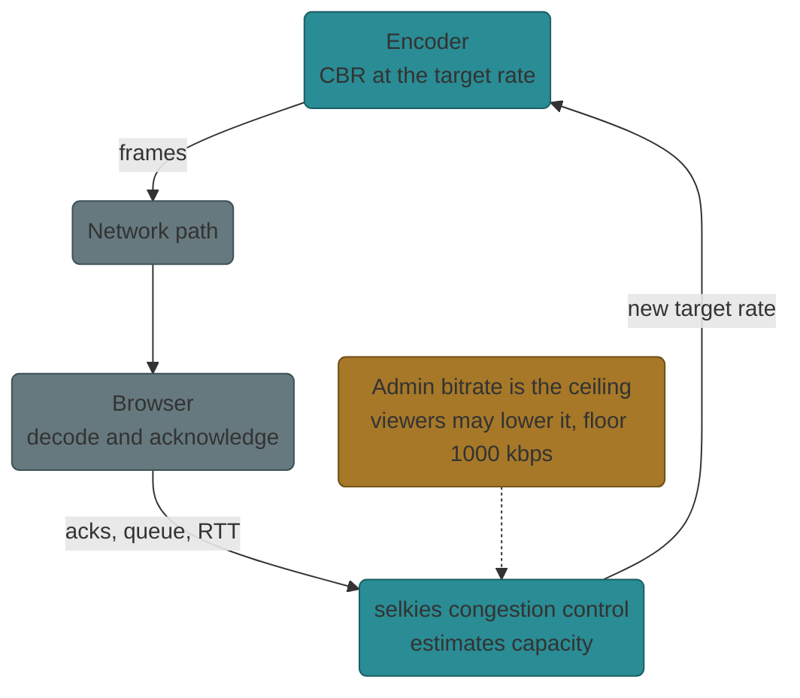

# Streaming tuning

You will choose sensible video settings for a workstation, understand which codec it streams, and tune idle behaviour. Based on agent 0.9.x (Selkies 2.1, pixelflux 2.2, pcmflux 2.2).

**Prerequisites:** an [enrolled workstation](workstations-enroll.md) and admin rights.



Settings live at **Settings → Administration → Workstations**, in a workstation's **Stream settings**. They are defaults per workstation; viewers can adjust most of them from the stream panel. Changes apply the next time nobody is connected, so they never interrupt a live session.

## Encoders {#encoders}

The agent offers codecs in this order and the viewer's browser uses the first it can decode:

**AV1, then HEVC, then H.264.**

1. **Hardware probe.** On start the agent probes the GPU once:
    - VA-API (AMD, Intel): `vainfo` must list an *encode* entrypoint for `VAProfileAV1` and/or `VAProfileHEVC`. Decode-only AV1 does not count.
    - NVIDIA: `nvidia-smi` compute capability decides. AV1 needs 8.9 or newer (Ada, RTX 40 series); HEVC needs 5.2 or newer (Maxwell 2 and later).
2. **Only codecs the GPU encodes go ahead of H.264.** Selkies would otherwise run a missing codec in software (SVT-AV1, x265) and pin the CPU. No render node, or no `vainfo`: the stream stays on H.264.
3. **The browser steps down.** A viewer without an AV1 decoder gets HEVC; without HEVC, H.264.

| GPU | Typical result |
|---|---|
| NVIDIA RTX 40 and newer | AV1, HEVC, H.264 offered |
| NVIDIA Maxwell 2 to RTX 30 | HEVC, H.264 |
| AMD/Intel with AV1 encode (for example Radeon 780M, VCN 4) | AV1, HEVC, H.264 |
| AMD/Intel with HEVC encode only | HEVC, H.264 |
| No GPU or no render node | H.264 on CPU (x264) |

Why AV1 first: the 2026-10-30 harness run on a Radeon 780M measured settled text about 35% sharper at 30 Mbps AV1 than at 16 Mbps H.264, with similar latency (p50 about 51 ms on a fast link) and no crashes over a 60-minute soak. AMD GPUs before VCN 5 pad the coded AV1 frame; the agent re-applies a client-side crop at start so the picture is not stretched.

### Codec selection flow



### When to prefer HEVC

AV1 is the best picture, but the *viewer* must decode it. Consider HEVC or H.264 when:

- the viewing device lacks hardware AV1 decode (older laptops and phones, many tablets): the browser either steps down or decodes AV1 on the CPU, which can drain battery and drop frames;
- you see high CPU on the viewer with a smooth host: the decode, not the network, is the bottleneck.

Admins pick the codec in the portal: open the workstation's **Stream settings** and set **Codec** (Auto, HEVC, AV1 or H.264). Pick HEVC for viewers without AV1 hardware decode. Viewers cannot change the codec from the stream panel.

!!! warning "Advanced: `stream-override.json`"
    An unsupported escape hatch for testing, not the normal way to set a codec. The file `~/.local/share/styx-agent/stream-override.json` on the workstation holds `args` that are appended to the Selkies command line (the last value wins). It is read whenever the engine starts or restarts, so remove it when you are done:

    ```json
    {"args": ["--encoder=h265enc,h264enc"]}
    ```


### Full colour (4:4:4)

Streams are 4:2:0 and hardware encoded. **Full colour (4:4:4)** gives crisp coloured text, but no VA-API driver encodes H.264 4:4:4, so the stream switches to software x264: more CPU, larger frames, and audio can stutter on a slow uplink. Leave it off unless text fidelity matters more than latency.

## Bitrate, framerate, quality

| Setting | UI label | Range / default | Effect |
|---|---|---|---|
| `framerate` | FPS | 30, 60 or 120; default 60 | Capture and encode rate. 120 only with a GPU and bandwidth headroom |
| `bitrate_kbps` | Max bitrate (kbps) | 500–200000 accepted by the agent, UI floor 1000; agent default 30000 (30 Mbps) | **Ceiling**: admin value is both the default and the maximum. Viewers may lower it (floor 1000 kbps) |
| `h264_crf` / `video_crf` | Quality (CRF) | 5–50; UI placeholder 25 | Lower is higher quality and more bandwidth. 15–20 for gaming quality |
| `h264_streaming_mode` | Gaming mode | off by default | Full-motion encoding: steadier latency under heavy motion, more bandwidth on a static desktop |
| `use_paint_over_quality` | Sharpen static screen | on | Re-encodes still screens at high quality (paint-over CRF 12) for crisp text |
| `video_fullcolor` | Full colour (4:4:4) | off | See above |

Notes:

- Rate control is **CBR** at the admin bitrate. Selkies 2.1 adapts the actual bitrate to the path (congestion control) up to that ceiling, so a lower ceiling is the lever for slow links, for example 16000 down to 8000 kbps.
- A stale 1.x bitrate value (8, meaning Mbps) is protected by the 1000 kbps floor.
- **Hardware encode is automatic** and needs a render node (`/dev/dri/renderD*`) and the user in the `render` group. `doctor` shows `GPU render node`. Without it you get CPU x264 and more latency.

The bitrate field shows 16000 only as a hint. Leave it empty and the agent uses 30000 kbps.

### How the bitrate adapts



## Resolution and scaling

Seats follow the owning browser's window size in device pixels, so a large HiDPI window streams a large frame. To cut encode cost, shrink the window or have the viewer turn **HiDPI off** (CSS pixels). `WORKSTATION_SEAT_WIDTH` × `WORKSTATION_SEAT_HEIGHT` (default 2560 × 1440) only size the seat before the first viewer connects. The maximum seat size is 4096 × 2304.

## Idle timeout and the activity heartbeat

### Workstations

The gateway enforces idle timeout on the server, so a throttled background tab cannot keep a seat alive.

- `WORKSTATION_IDLE_TIMEOUT_ENABLED` (default on), `WORKSTATION_IDLE_TIMEOUT_S` (default 900), `WORKSTATION_IDLE_WARN_LEAD_S` (default 60, clamped below half the timeout). Override per workstation with the same-named keys in stream settings ([Settings reference](settings.md#per-workstation-overrides)). Idle-timeout changes apply immediately and reconnect viewers.
- Only real input resets the clock: keyboard, pointer, wheel, clipboard and resize messages. Protocol traffic (frame acknowledgements, start/stop video, settings, stats, pong) is ignored by design, so an open but unattended tab cannot hold the seat.
- At `timeout − lead` the viewer shows "Disconnecting in Ns due to inactivity — move to stay". At the timeout the socket closes and **Reconnect** appears.
- Turn the switch off to let seats run indefinitely (no warning, no disconnect).

### Desktop instances

Instances use the template's `session_config` (idle timeout and grace period, see [Templates and instances](templates-instances.md)). The viewer's desktop tab sends an **activity heartbeat** about once a minute: it counts keyboard, pointer, wheel and touch input in the last 5 minutes, or on-screen motion within the last 2 minutes while the tab is visible (sampled every 10 seconds from a tiny downscaled copy of the video). Audio-only playback is not detected. After the idle timeout the instance becomes *idle* and the user sees **Pausing soon due to inactivity** with **I'm here**; after the grace period it is stopped.

## Host tuning

`styx_agent.py doctor` checks and advises on:

- **NVIDIA persistence mode:** `sudo nvidia-smi -pm 1` removes the GPU initialization stall at stream start.
- **CPU governor:** `sudo cpupower frequency-set -g performance` on dedicated gaming boxes holds peak frequency.

## Operational tips

- **Tab visibility:** the stream pauses when its tab is backgrounded and resumes on return (by design; prevents long-session memory growth). Refresh if it ever sticks.
- **Audio latency:** audio adds about 100–250 ms after settling. Disable it for competitive play.
- **Slow uplinks:** keep Full colour (4:4:4) off and lower the bitrate ceiling.
- **Game seats:** turn on Gaming mode, use CRF 15–20, 60 FPS (120 with headroom).
- **Measuring changes:** the repo ships a stream A/B harness (`e2e/stream-ab/`) that drives headless Chromium through simulated network profiles; see [Build: Testing](../build/testing.md).
