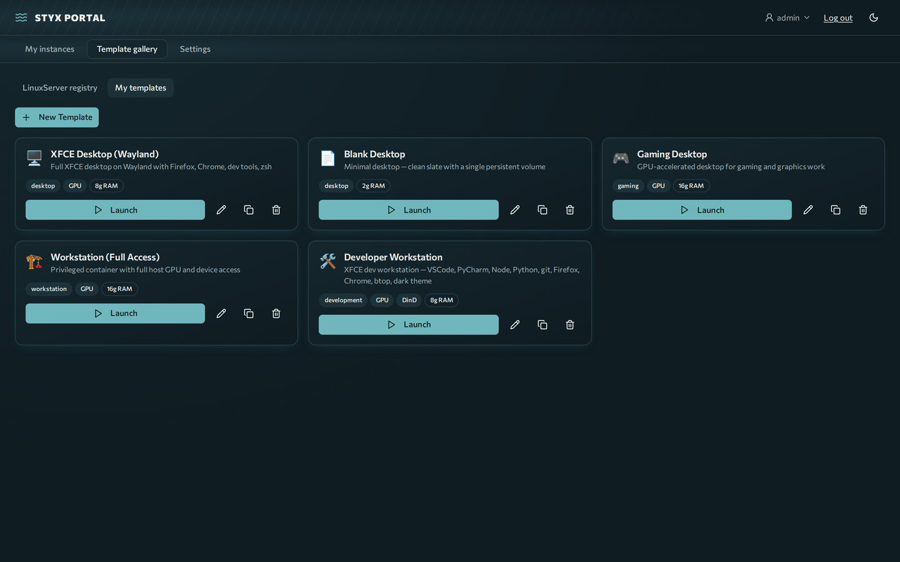

# Templates and instances

You will understand how instances are built from templates, which images stream, and how to create, restrict and cap templates. End users: see [Use: Desktops](../use/desktops.md).

**Prerequisites:** admin rights.

An **instance** is a containerized desktop (or app) you launch from a **template**
and use in your browser. It's the core unit of Styx Portal: each instance is a
Docker container running a streaming desktop, reachable at its own subdomain, with
its data persisted in a Docker volume.

## What an instance is

- **A Docker container** created from a template's image, started on the host the
  portal runs on.
- **Streamed to your browser** — the container runs a full Linux desktop and serves
  a [Selkies](https://github.com/selkies-project) WebRTC stream that renders in a
  browser tab. No VNC client, no extra software.
- **Persistent** — a named Docker volume (mounted at `/config`) survives stop,
  restart, and rebuild, so your home directory and installed apps stick around.
- **Isolated** — each user's instances run on their own private Docker network.

## How it works

When you launch an instance, the backend:

1. **Pulls the image** (if not already cached), streaming progress to the UI.
2. **Creates the volumes** named for this instance (e.g. `<id>-home` → `/config`).
3. **Creates the container** named `selkies-<subdomain>` with the template's image,
   environment, resource limits, and security settings. It injects
   `PIXELFLUX_WAYLAND=true` (and `AUTO_GPU=true` when GPU is enabled).
4. **Starts it** and writes a **Traefik** route: `https://<subdomain>.<domain>` →
   `<protocol>://selkies-<subdomain>:<internal_port>` (default `https` / `3001`).
5. Your browser opens that subdomain and **Selkies streams the desktop** over WebRTC.

```
browser ──https──▶ Traefik (TLS edge) ──▶ selkies-<subdomain>:3001 (Selkies WebRTC)
                                                  │
                                          /config  (persistent volume)
```

Idle instances are managed by `session_config`: after `idle_timeout` of no activity the instance turns **idle** (the user sees **Pausing soon** and **I'm here**); after a further `grace_period` it is auto-stopped (configurable per template). Activity comes from the user's browser tab: input, or visible motion on screen, reported about once a minute.

## linuxserver.io integration

Styx Portal is built around **[linuxserver.io](https://www.linuxserver.io/)'s
`baseimage-selkies`** images. Every bundled template uses
`ghcr.io/linuxserver/baseimage-selkies` (or an image derived from it), and the
portal assumes that image family's conventions throughout:

| Convention | Where it comes from | Used for |
|------------|---------------------|----------|
| **`PUID` / `PGID`** (default `1000`) | linuxserver.io base images | Run the desktop as your uid/gid; correct file ownership in `/config` |
| **`/config` volume** | linuxserver.io persistence convention | Home directory + app data that survives rebuilds |
| **Port `3001`, HTTPS** | `baseimage-selkies` serves Selkies here | Traefik routes the browser stream to it |
| **`AUTO_GPU=true`** | linuxserver.io GPU auto-detect | Picks up host NVIDIA/Intel/AMD GPUs |

Because of this, **linuxserver.io selkies images (and images built on top of them)
are the supported, batteries-included way to run instances.** The bundled
templates — Blank, XFCE Desktop, Developer Workstation, Gaming — are all of this
family. You can extend them or add your own that derive from `baseimage-selkies`
and everything (streaming, screenshots, GPU, persistence) just works.

## Using images from a registry — important caveat

A template's `image` can point at **any** container image from any registry
(GHCR, Docker Hub, `lscr.io`, a private registry). **But the portal does not
validate that the image is Selkies-based, and only Selkies-based images can be
streamed.**

!!! warning "Not every registry container will work as an instance"
    The portal expects the container to serve a **Selkies web UI** on its
    `internal_port` (default `3001`, HTTPS). If you point a template at an image
    that is **not** Selkies-based — a plain `nginx`, a bare Ubuntu, a generic app
    container, or another remote-desktop stack that isn't Selkies — the instance
    will **start** (Docker shows it "running") but:

    - the browser tab shows **502 Bad Gateway / SSL error** instead of a desktop
      (Traefik is routing to a Selkies stream that isn't there),
    - the **thumbnail/screenshot stays blank** (the capture probe looks for the
      Selkies canvas and times out),
    - **idle detection is unreliable** (it relies on the browser's keepalive,
      which never connects).

    There is no health check that catches this — the failure is silent. **If you
    want a desktop you can stream, use a `linuxserver.io baseimage-selkies` image
    or one derived from it.** Non-Selkies images are only suitable if you've added
    your own Selkies layer that serves the expected web UI on the configured port.

If you must use a non-default image, set `internal_port` / `internal_protocol` to
whatever Selkies-compatible endpoint it actually serves — but the image still has
to speak the Selkies streaming protocol for the browser view to work.

## Template fields

Templates are JSON (seeded from `templates/*.json` on first run, editable in the template editor). Bundled: **Blank Desktop**, **XFCE Desktop (Wayland)**, **Developer Workstation** (DinD, admin-only), **Gaming Desktop** and **Workstation (Full Access)**. Idle and grace defaults differ per template (for example 14m/1m for Blank and Gaming, 60m/10m for XFCE and Developer, 120m/15m for Workstation). The
fields that shape an instance:

| Field | Default | What it controls |
|-------|---------|------------------|
| `image` | — | Container image (registry path). **Must be Selkies-based to stream.** |
| `internal_port` | `3001` | Port the container serves the Selkies UI on; Traefik routes here |
| `internal_protocol` | `https` | `https` for Selkies (`http` only if your image serves plain HTTP) |
| `env_vars` | `{}` | Environment injected into the container (`PUID`, `PGID`, encoder opts, …) |
| `volumes` | `[]` | Persistent named volumes, e.g. `{"name": "{instance_id}-home", "mount": "/config"}` |
| `memory_limit` / `cpu_limit` | none | Docker resource caps (`2g`, `8.0` …) |
| `shm_size` | none | Shared memory (GUI apps need this, e.g. `512m`) |
| `gpu_enabled` / `gpu_count` | `false` / `1` | GPU passthrough (auto-detects NVIDIA/Intel/AMD) |
| `cap_add` / `security_opt` | `[]` | Linux capabilities / security options (defaults run unprivileged) |
| `session_config` | 14m idle / 1m grace / stop | Idle timeout, grace period, max session, never-timeout |
| `tls_skip_verify` | `false` | Skip cert check when routing to the container's HTTPS port |
| `dind`, `privileged`, `devices`, `tmpfs`, `entrypoint`, `command` | off / none | Advanced container options |

`session_config` example:

```json
{
  "idle_timeout": "14m",
  "grace_period": "1m",
  "timeout_action": "stop",
  "never_timeout": false,
  "max_session_duration": null
}
```

## Related

- **[GPU](gpu.md)** — enabling GPU acceleration for instances.
- **[Enroll workstations](workstations-enroll.md)** — streaming a *physical* machine (also Selkies-based) rather than a container.
- **[Users, groups and SSO](users-groups-sso.md)** — accounts and access.

## Create a template

1. Open **Template gallery** and choose **New Template**.
2. Fill the editor sections: **Basics** (name, image), **Resources** (memory, CPU, shared memory, restart policy, GPU passthrough), **Ports and network**, **Storage** (read-only root filesystem), **Environment**, **Security** and **Raw Docker** (entrypoint, command, extra Docker args).
3. Save. Security and Raw Docker fields are admin-only. On Kubernetes the Docker-only fields are hidden.



## Admin-only fields {#admin-only-fields}

- **`cap_add`:** extra Linux capabilities (default `[]`). **Selkies / LinuxServer desktop images need a capability set to boot.** Their s6 init runs `chown` and drops privileges, which `cap_drop: ALL` blocks (symptom: `chown ... Operation not permitted`, `s6-applyuidgid: fatal`). Give such templates at least `CHOWN, SETUID, SETGID, DAC_OVERRIDE, FOWNER`. The bundled seed templates ship the full standard set.
- **`security_opt`:** security options (default `[]`). **GPU desktop templates that do framebuffer capture (Selkies/pixelflux) need `seccomp=unconfined`.** The default seccomp profile blocks syscalls the capture path uses (symptom: a `pixelflux`/Rust `PermissionDenied` panic and a black screen with "websocket disconnected"). The seed templates ship `["seccomp=unconfined","apparmor=unconfined"]`. The rest of the isolation (non-root backend, socket-proxy, per-user networks, audit, quotas) still applies; only the desktop container's own seccomp is relaxed.
- **`tls_skip_verify`:** set to true if the template serves self-signed HTTPS internally. **All Selkies desktop images do**, so every `https` template needs it (else Traefik fails certificate verification and the instance 502s). Seed templates set it.

## Docker-in-Docker templates

Templates with Docker-in-Docker must:

- be marked DinD-capable (checkbox in the template editor);
- have memory and CPU limits (enforced on creation);
- be admin-only (non-admins cannot launch);
- are logged in the audit log.

## Quotas and overrides

- **Per-user limit:** `MAX_INSTANCES_PER_USER` (default 3, 0 = unlimited, admins exempt). Change it live in **Settings → Administration → Settings → Quotas** ([reference](settings.md#quotas)). Non-admins who hit the cap see an error and must stop an instance first.
- **Rate limit:** instance creation is also limited per user (`RATE_LIMIT_INSTANCE_CREATE`, default 10 per hour).
- **Resource overrides (admin):** on launch, admins can override memory, CPU, shared memory, environment variables and, if the template allows, capabilities.
