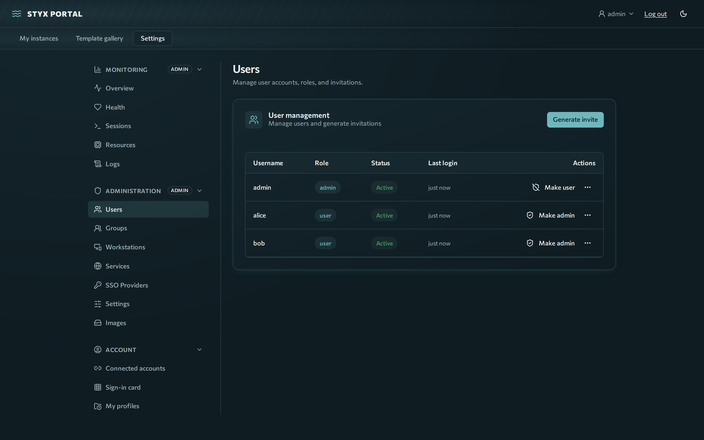
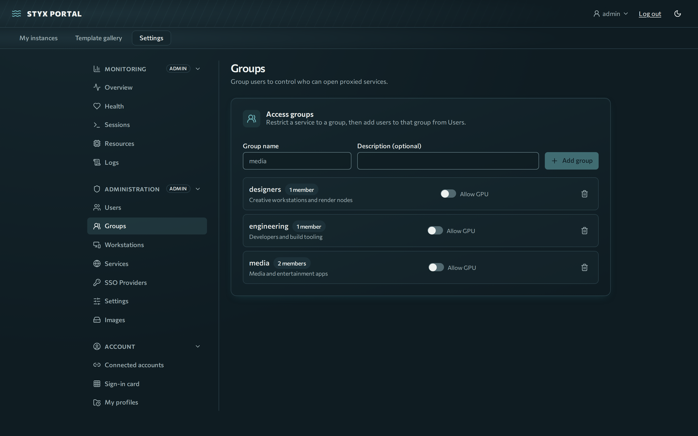
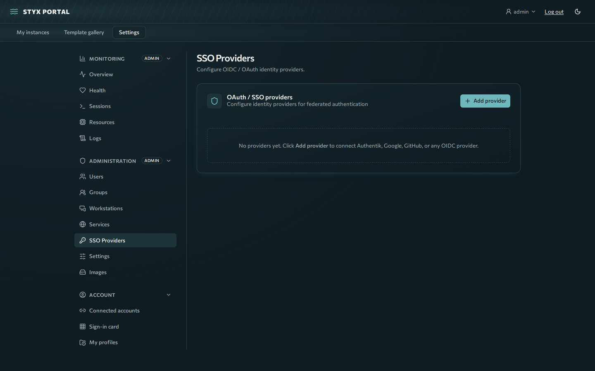

# Users, groups and SSO

You will invite users, set roles, group them for app access, connect an SSO provider, and recover from lockouts or lost sign-in cards.

**Prerequisites:** admin rights.

## Invite users



1. Go to **Settings → Administration → Users**.
2. Press **Generate invite**.
3. Copy the single-use link (valid 72 hours) and share it securely. The recipient chooses a username and password and joins the portal.

## Roles and account actions

- **User:** launches instances from templates and manages only their own.
- **Admin:** manages users, templates, SSO providers, services, workstations, quotas and the Health page.

In the Users panel, a user's **More actions** menu offers: **Make admin** / demote, **Disable**, **Unlock**, **Reset password** (issues a temporary password and forces a change; revokes the user's sessions), **Reset sign-in card** (only shown when the user has one) and **Delete user permanently**. Disabling, deleting or demoting a user drops their live workstation stream at the next agent heartbeat.

## Groups



Create groups under **Settings → Administration → Groups** and assign users. Groups control who can open proxied services: a service lists allowed groups by **name**. An empty list means every signed-in user; admins can always open everything. Deleting a group removes it from every service, and a service left with no groups becomes **disabled** (fail closed). See [Proxied services](services.md#groups).

## SSO providers



Styx supports OIDC and OAuth2 (Authentik, Keycloak, Google, GitHub, any compatible provider).

1. Open **Settings → Administration → SSO Providers** and press **Add provider**.
2. Enter **Name**, **Issuer URL** (the OIDC discovery base, for example `https://accounts.google.com`), **Client ID** and **Client Secret**. Secrets are stored encrypted (Fernet, key derived from `JWT_SECRET`).
3. Set the options:
    - **Trust email:** if on, an unverified IdP email is accepted only for subjects already linked or for brand-new self-signup. It never links to an existing account or matches an invite. Enable only for IdPs you control.
    - **Allow signup:** if on, users can sign up directly, but only when the role map's **user group** is set and the person is in it (no open signup). If off, they must match an existing user or an invite.
    - **Auto-promote admins:** if on, members of the provider's admin group (claims) become admins; if off, the claim is noted in the audit log but promotion is manual.
    - A custom OAuth2 provider whose userinfo lacks `sub` can set `subject_claim` in the role map (for example `id`). Sign-in is refused when no subject is found.
4. Register the redirect URIs with the provider (replace `<provider_name>` with the lowercase, URL-safe slug):

| Purpose | URI |
|---|---|
| Login | `https://styx.example.com/api/auth/oauth/<provider_name>/callback` |
| Account linking | `https://styx.example.com/api/auth/link/<provider_name>/callback` |

Identity details come from the provider's userinfo endpoint (no id_token or JWKS parsing). Provisioning is pre-authorized only: the verified email must match an existing user or an open invite.

**Account linking:** signed-in users link and unlink providers under **Settings → Account → Connected accounts**. Linking always needs a verified email regardless of `trust_email`. An only login method cannot be unlinked. SSO sign-in never auto-links to an admin account.

## Sign-in cards (2FA)

Users enroll cards themselves ([Use: Getting started](../use/getting-started.md#add-a-sign-in-card-2fa)). Admin side:

- **Lost card, user cannot sign in:** **More actions → Reset sign-in card** (audit action `matrix.admin_reset`).
- **Last resort, direct database recovery:**

    ```bash
    docker compose exec backend python -c "import sqlite3;c=sqlite3.connect('/app/data/styx-portal.db');c.execute(\"update users set matrix_card=NULL,matrix_pending=NULL,matrix_challenge=NULL,matrix_serial=matrix_serial+1 where username='<name>'\");c.commit()"
    ```

    On Kubernetes use `kubectl -n styx exec deploy/backend -- python -c "..."` with the same statement.
- **Lockouts are in memory.** After a reset, a locked-out user stays locked until 15 minutes pass, an admin presses **Unlock**, or the backend restarts (`docker compose restart backend`, or `kubectl -n styx rollout restart deploy/backend`).
- **Cards are encrypted with a key derived from `JWT_SECRET`.** If `JWT_SECRET` (or `/app/data/secrets.json`) is lost or changed, no stored card can be read and card sign-in returns a 500. Reset the card as above and enroll a new one.
- **Session length:** card sign-ins are session-only and capped at **Card session max age (h)** (`MATRIX_SESSION_MAX_HOURS`, default 12, 1–168), including in proxied apps and workstations.

## Operations checklist

- [ ] All expected users invited and accounts created
- [ ] At least one SSO provider configured (if you use SSO)
- [ ] GPU templates set up (if you have GPUs)
- [ ] Audit log reviewed ([Monitoring](monitoring.md#audit-log))
- [ ] Instance quota matches your policy
- [ ] Health page green
- [ ] `secrets.json` backed up
- [ ] DinD templates have memory and CPU limits
