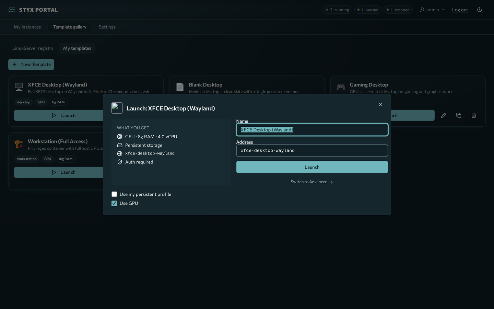
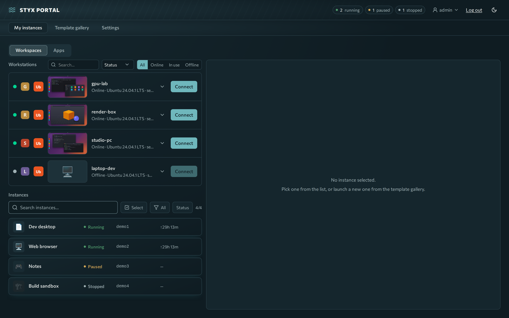
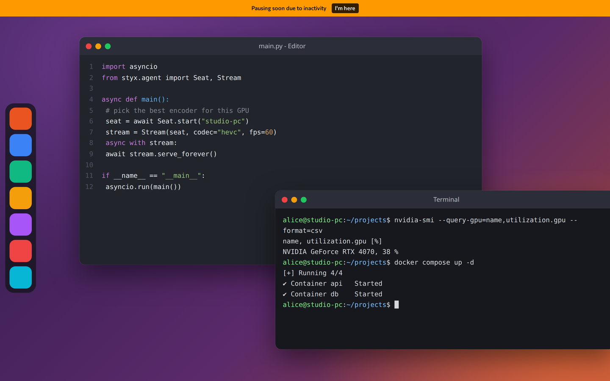
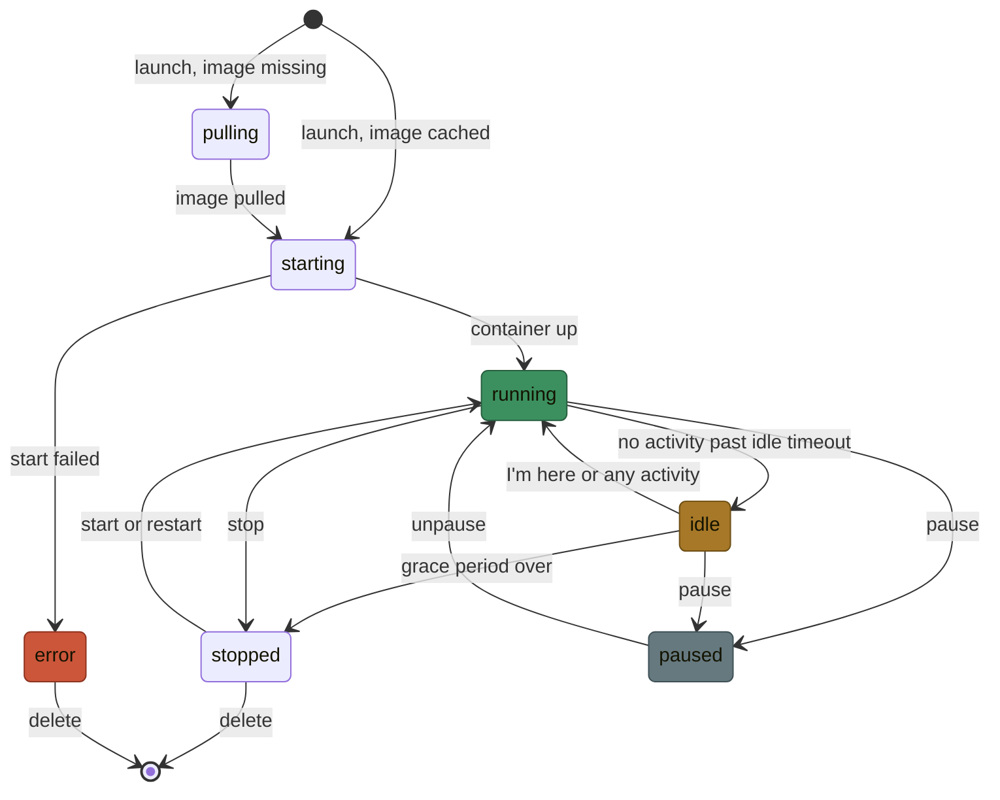

# Desktops

A **desktop** (an *instance*) is a containerized Linux desktop you launch from a template and use in a browser tab. Your files live in a persistent volume, so they survive stop, restart and rebuild.

**Prerequisites:** a signed-in account. Admins may cap how many desktops you can run at once (default 3).

## Launch one

1. Open the **Template gallery**.
2. Pick a template (bundled: Blank Desktop, XFCE Desktop (Wayland), Developer Workstation, Gaming Desktop, Workstation (Full Access)) and launch it.
3. The portal pulls the image if needed, showing progress, then starts the container.
4. Open it from **My instances**. The desktop streams in a new tab at its own address.

!!! info "Images must be Selkies-based"
    Only [linuxserver.io `baseimage-selkies`](https://www.linuxserver.io/) images (or images derived from them) stream. A plain image starts, but shows 502 or SSL errors, a blank thumbnail and unreliable idle detection. See [Templates and instances](../operate/templates-instances.md).

## Keep it awake: idle and "I'm here"

Desktops stop themselves when nobody uses them, to free the host.

- After the template's **idle timeout** (14 minutes on Blank and Gaming, 60 on XFCE and Developer, 120 on Workstation) with no activity, the desktop turns **idle**.
- While idle, the desktop page shows a banner **"Pausing soon due to inactivity"** with an **I'm here** button. Press it, or use the desktop, to cancel the stop.
- If nothing happens for the **grace period** (1 to 15 minutes depending on the template), the container is stopped. Stopped desktops keep their data and can be started again.

What counts as activity: keyboard, mouse and touch input in the desktop tab, or visible motion on screen while the tab is in view. Audio-only playback is not detected, so press **Keep awake** in the instance detail pane for long music or downloads. Templates can also be set to never time out.

Defaults are 14 minutes idle, then a 1 minute grace period before the action (stop). Some bundled templates use longer timeouts (for example 60 minutes for the XFCE and Dev desktops, 120 for Workstation); check the template's session settings.

### Desktop states

Every desktop is in one of these states. Pause is a manual action; idle and the automatic stop come from the idle timeout.

## Stop, restart, delete

From the instance card or detail pane you can stop, start, restart, recreate (new container, same volumes) or delete a desktop. Deleting removes the container and the instance's own volumes. The instance's own volumes are removed with it. A saved per-template profile is kept unless you tick the delete-profile option; you can also reset it under **Settings → Account → My profiles**. A profile still used by another instance is never deleted.

## Next

- [Workstations](workstations.md) for streaming a real machine.
- [Troubleshooting](troubleshooting.md).
