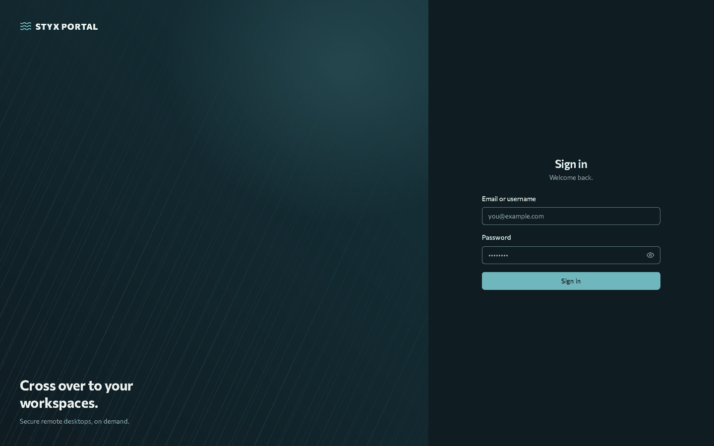
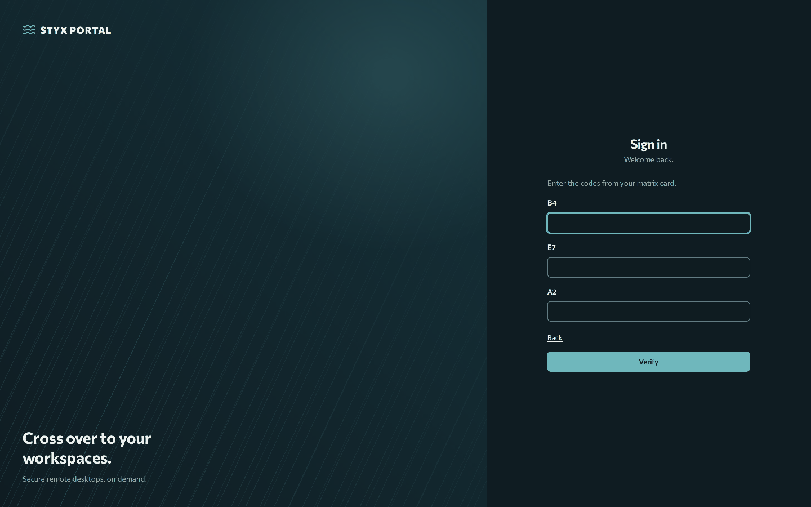
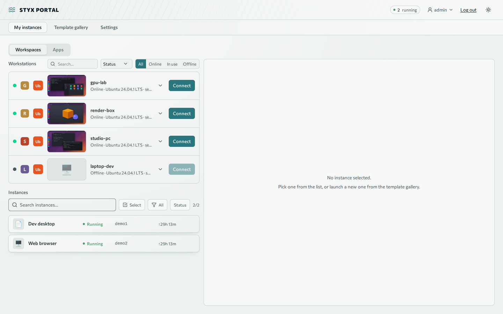

# Getting started

You will sign in, optionally add a second factor, and find your way around the portal.

**Prerequisites:** the portal address (for example `https://styx.example.com`) and either an invite link from an admin or an SSO account.

## The ways in

## Accept an invite

1. Open the invite link an admin sent you. It is single-use and valid for 72 hours.
2. Choose a username and password. The form shows the password rules the admin configured (minimum length, required character classes) and a strength meter.
3. You are signed in.

## Sign in

- **Password:** enter your username and password.
- **SSO:** if the admin configured a provider (Google, GitHub, Authentik, Keycloak or any OIDC/OAuth2 provider), its button appears on the sign-in page. SSO only works for people who already have an account or an open invite whose email matches the provider's verified email.
- **Session expiry:** a prompt warns you shortly before your session ends. Choose **Stay signed in** to refresh it.

!!! note "Repeated failures lock the account"
    Too many wrong passwords lock the account for a while, and too many failures from one address ban that address. Ask an admin to **Unlock** you if you cannot wait. See [Security](../operate/security.md).

## Add a sign-in card (2FA)

A sign-in card is a printed grid of codes used as a second step after your password.

1. Open **Settings → Account → Sign-in card** and choose **Generate card**. Enter your account password.
2. The 10 × 5 card (columns A–E, rows 1–10) is shown **once**. Download the PNG or print it.
3. Enter the cell the portal asks for (for example `C7`) to activate the card.

From then on, password sign-in asks for three random cells.

- **Lost card:** if you can still sign in, **Regenerate** (needs your password) or **Remove** it. If you cannot, ask an admin to **Reset sign-in card** for you.
- **Session length:** a card sign-in is a session-only login. It ends when you close the browser and after a fixed maximum age (default 12 hours, set by the admin), even in proxied apps and workstations.
- A wrong current password on **Change password** counts as a failed sign-in.

## Link an SSO account

Under **Settings → Account → Connected accounts** you can link or unlink a provider to your account. Linking always needs a verified email. You cannot unlink your only way to sign in. Admins link providers while signed in; SSO sign-in never auto-links to an admin account.

## Find your way around

| Place | What it is |
|---|---|
| **Home → Workspaces** | Your desktops and the workstations you may use, with live thumbnails |
| **Home → Apps** | Tiles for the proxied apps your groups allow |
| **My instances** | List of your containerized desktops |
| **Template gallery** | Start a new desktop from a template |
| **Settings** | Your account (connected accounts, sign-in card, profiles); admins also see Monitoring and Administration |

Next: [Desktops](desktops.md) or [Workstations](workstations.md).
