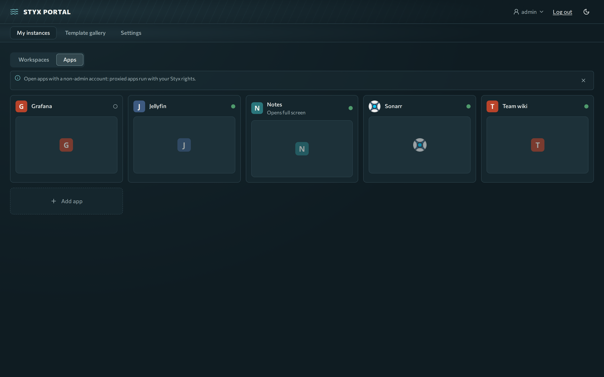
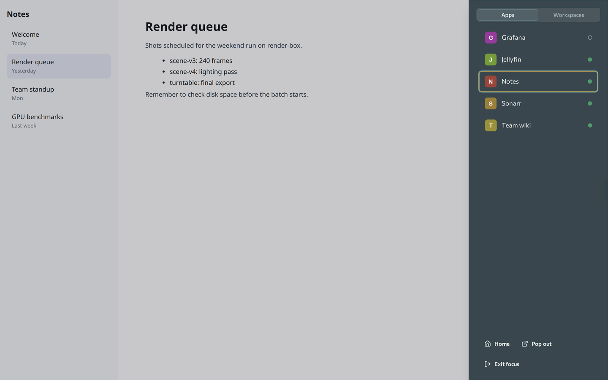

# Apps and the shell

Admins can put internal apps (Jellyfin, the \*arr stack, Nextcloud, Home Assistant, GitLab and more) behind the portal's single address. You sign in once and open them from tiles.

**Prerequisites:** a signed-in account in a group that the admin allowed for the app.

## Open an app

1. Go to **Home → Apps**. Tiles show a health dot; unhealthy tiles stay clickable.
2. Click a tile. The app opens in the **Styx shell**, a full-window frame at `/_styx/app/<slug>/` that follows the app's address and title, so reloads and deep links work.
3. Apps flagged **Open without overlay** skip the shell and open on their own.

## The dock

- **Edge tab:** a handle on the screen edge. Click or tap it to open the dock; drag it along the edge to move it. It remembers its place per device and fades when idle.
- **Alt+Shift+S** toggles the dock, even while focus is inside the app. **Esc** closes it.
- The dock lists your apps with health dots. Pick one to switch. Actions: **Home**, **Pop out** (bare app in a new tab) and, for focus apps, **Exit focus**.
- If an app refuses to be framed you will see "&lt;app&gt; can't run inside Styx" with **Open &lt;app&gt; on its own**.

## Focus apps

Apps that only run at the site root (Home Assistant, Immich, Audiobookshelf, Unraid) open in **focus** mode: the tile says "Opens full screen", and the app takes over `/` for your browser. Only one focus app is active per browser; other browsers and devices are unaffected.

- To leave: use the dock's **Home** or **Exit focus**, or visit `https://styx.example.com/_styx/exit`.
- While a focus app is active, reloading `/` in another Styx tab shows the focus app. Use **Exit focus** to return.
- If a link to open a focus app comes from another site, Styx asks "Open app?" first so nobody else can change your focused app.

## Phone and desktop apps

Mobile apps cannot go through the browser sign-in. If an admin turned on **Allow native apps** for a service (for example Jellyfin), enter `https://styx.example.com/jellyfin` as the server address in the app and sign in with the app's own account.

!!! warning "Apps are trusted code"
    A proxied app's JavaScript runs on the same origin as Styx and can act with your Styx rights. Use a non-admin account for day-to-day app use.
