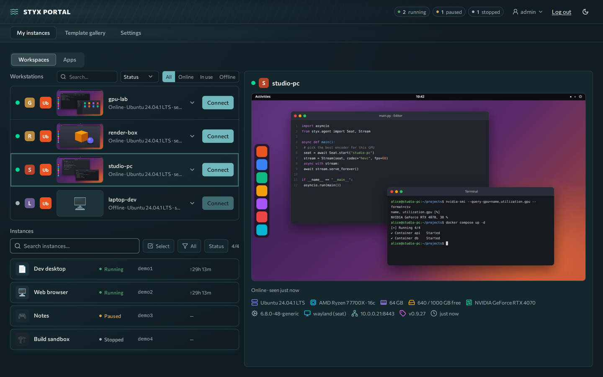
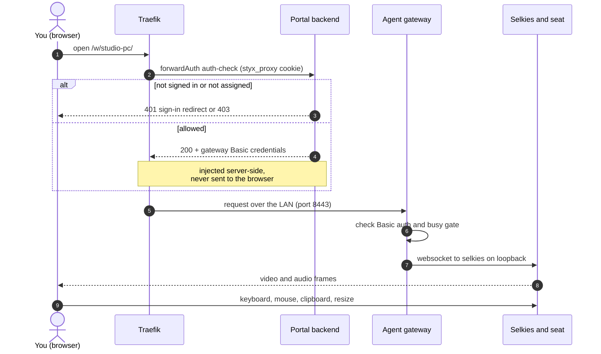
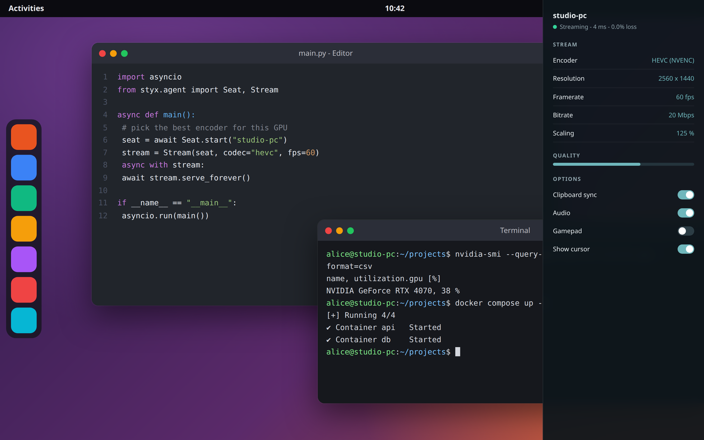
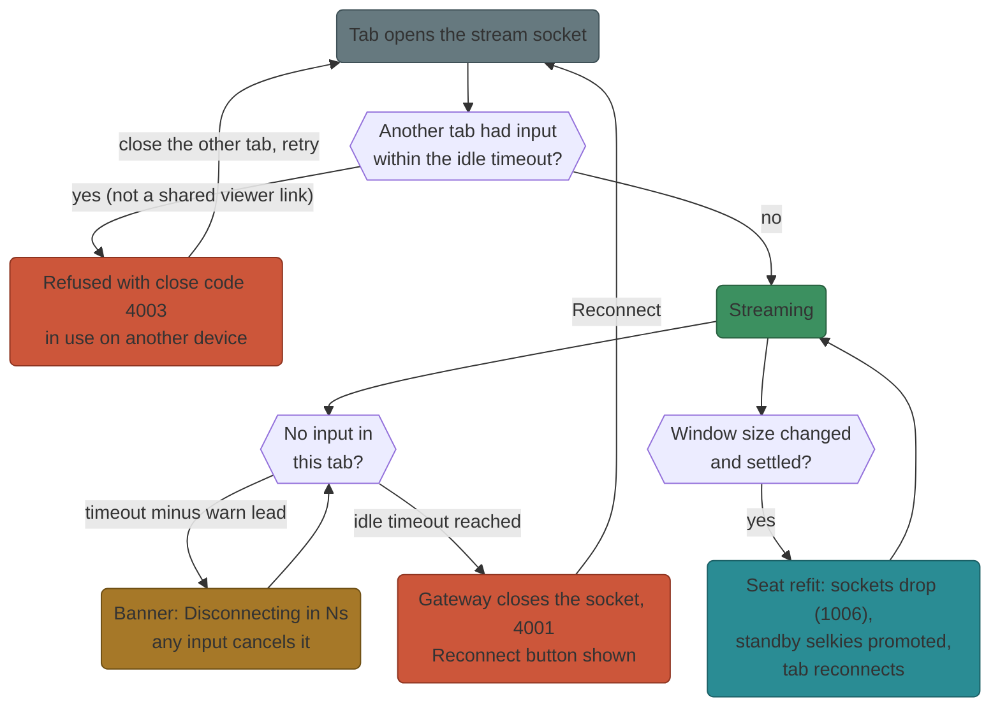

# Workstations

A **workstation** is a physical (or virtual) Linux machine that an admin enrolled in Styx. You stream its desktop to your browser, with audio, clipboard and file transfer.

**Prerequisites:** a signed-in account that an admin granted access to the workstation.

## Connect

1. On **Home → Workspaces**, find the workstation card. Cards show a live preview and a status badge: **Online**, **Offline**, **Pending** or **Revoked**.
2. Click **Connect** on an online card. The stream opens in a new tab at `/w/<name>/`.
3. If you get a 401 you are not signed in; a 403 means you are not assigned to that workstation. Ask an admin.

!!! note "Seats belong to one user"
    Another user cannot open your live seat by URL. They must use **Connect with takeover**, which grants a 60-second window.

### What happens when you connect

## The stream panel

The Selkies sidebar controls the stream:

- **Resolution:** presets or a manual size. The seat resizes in place to match your browser window; anything below 640×480 is clamped and the maximum is 4096×2304.
- **UI scaling / HiDPI:** switch between GNOME scale 1 and 2 without restarting the stream. Turning **HiDPI off** (CSS pixels) streams a smaller frame on large retina windows and cuts encode cost.
- **Bitrate:** you may lower it; the admin's value is the ceiling and the floor is 1000 kbps.
- **Framerate, quality, Gaming mode, Sharpen static screen, Full colour (4:4:4):** admin values are the starting defaults; you can change them for your session.
- **Ownership:** the connected controller owns the seat size. A second viewer takes the seat only when the first leaves; shared viewers (`#shared` links) watch at the controller's size. Sharing links work only for people signed in to the portal.

Admin changes apply when nobody is connected, so they never kick an active session. Idle-timeout changes apply at once.

## Clipboard, files, audio

| Feature | How it works |
|---|---|
| **Audio** | Automatic. In seat mode audio is isolated into a dedicated sink, so nothing plays from the machine's physical speakers. Audio adds roughly 100–250 ms of latency; turn it off for competitive play. |
| **Clipboard** | Automatic two-way sync in Chromium-based browsers once you allow the site's **Clipboard** permission (lock icon → Site settings → Clipboard → Allow). Firefox blocks programmatic clipboard reads, so local-to-remote paste goes through the sidebar's clipboard panel. |
| **Files** | Sidebar **Files** section. Uploads land in `~/Downloads` on the workstation; the download popup lists the same directory. |
| **Microphone, webcam, gamepad, printing** | Off in current agents. |
| **Second screen** | Disabled (upstream limitation). |

## Quality and codecs

The stream tries **AV1, then HEVC, then H.264** and uses the first codec your browser can decode and the workstation's GPU can encode. If your device has no AV1 decoder (older laptops, many phones), the stream steps down to HEVC automatically. See [Streaming tuning](../operate/streaming-tuning.md) for the details and when to prefer HEVC.

Tips:

- Big HiDPI window feels heavy? Shrink the window or turn **HiDPI off**.
- Slow uplink? Lower the bitrate in the panel and leave **Full colour (4:4:4)** off.
- Text looks soft? Leave **Sharpen static screen** on; it re-sharpens the picture once motion stops.

## Idle timeout

Workstation streams disconnect after a period without input (admins set it; default 15 minutes). A countdown **"Disconnecting in Ns due to inactivity — move to stay"** appears first; any mouse or key activity cancels it. After the timeout, **Reconnect** reopens the stream. Admins can turn the timeout off.

### Idle, another device, resize

What the stream does when you go idle, open it on a second device, or resize the window.

## Stream behaviour to know

- **Tab visibility:** the stream pauses while its tab is in the background and resumes when you return. Refresh the tab if it ever sticks.
- **Keyboard:** keys go to the remote desktop while the stream tab has focus.
- **Cursor:** on the GNOME seat the cursor is drawn by the browser locally for responsiveness.

- **Shortcuts:** the viewer adds none of its own. The only portal shortcut is **Alt+Shift+S**, which opens the Styx menu in the shell.
- **Codec:** viewers cannot pick it in the panel. Admins set it under the workstation's **Stream settings**, and the browser decodes what it supports.

Having trouble? See [Troubleshooting](troubleshooting.md).
